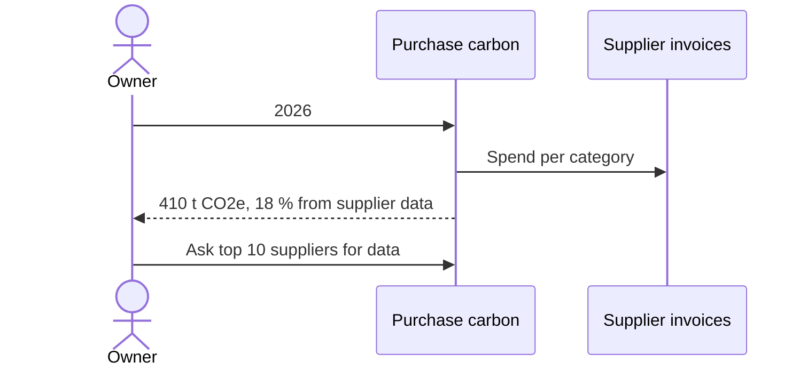

🏠 [Specs](../../../../README.md) › 🧩 [Functional capabilities](../../../README.md) ›
📦 [F7 Purchasing and stock](../../README.md) › 📝 [Use cases](../README.md) ›
📝 [Use cases: FL-F7-09 Compliance and carbon](README.md) › 📝 UC-F7-24 Measure the carbon of purchases

# 📝 UC-F7-24 Measure the carbon of purchases

**Status:** 🔄 waiting for the owner

## Summary

The owner reads the estimated emissions of the company's purchases (scope 3) per supplier and category, from suppliers'
data where given, or from spend-based factors.

## Personas

- [U13 Owner](../../../../01-users/personas/u13-owner.md)
- [U04 Purchasing and stock](../../../../01-users/personas/u04-purchasing.md)
- [U05 Accounting](../../../../01-users/personas/u05-accounting.md)

## Goal

Know which purchases weigh most, and answer customers' and banks' questions.

## Trigger

A yearly report, a customer questionnaire, the sustainability report,
[UC-F8-28](../../../f08-accounting/use-cases/09-pay-analyse-and-report/uc-f08-28-prepare-the-sustainability-report.md).

## Frequency

Yearly; quarterly where asked.

## Preconditions

- Posted supplier invoices with categories.

## Postconditions

- **Succeeded:** emissions per supplier and category, each with its method
  ([BR-F7-17](../../business-rules/br-f07-17-carbon-figures-say-how-they-were-computed.md)).
- **Failed:** invoices without a category are listed.

## Main flow

1. The owner opens Purchase carbon ([S-F7-24](../../screens/09-compliance-and-carbon/s-f07-24-purchase-carbon.md)) for
   the year.
2. simple-ERP applies emission factors per category to spend, or the supplier's own product data where provided.
3. It shows the total, per supplier and per category, with the share computed from supplier data.
4. The buyer asks the main suppliers for their data through the portal
   ([UC-F7-12](../01-procure/uc-f07-12-use-the-supplier-portal.md)).

## Alternative flows

- 2a. Transport purchases use the carrier's CO2 information
  ([CR-FR-120](../../../../10-country-packs/france/transport/cr-fr-120-co2-information.md)).

## Error flows

- 2e. Invoices without a category: not counted, listed with their amount.

## Business rules

- [BR-F7-17 Carbon figures say how they were computed](../../business-rules/br-f07-17-carbon-figures-say-how-they-were-computed.md)

## Entities

- [E-F7-20 Emission factor](../../data/e-f07-20-emission-factor.md)
- [E-F7-05 Supplier invoice](../../data/e-f07-05-supplier-invoice.md)

## Permissions

The owner, purchasing and accounting.

## Notifications

None.

## Audit events

Factors changed; supplier data received.

## AI involvement

The AI assistant prepares it for confirmation
([BR-F3-07](../../../f03-assistant/business-rules/br-f03-07-no-deletes-no-irreversible-acts.md)); figures come from
queries ([BR-F3-03](../../../f03-assistant/business-rules/br-f03-03-figures-come-from-queries.md)).

## API, MCP and A2A exposure

T5 operations of F7 with the caller's rights; the MCP tool of F7; no A2A skill.

## Screens

- [S-F7-24 Purchase carbon](../../screens/09-compliance-and-carbon/s-f07-24-purchase-carbon.md)

## Flowchart

See [FL-F7-09 Compliance and carbon](../../flows/fl-f07-09-compliance-and-carbon.md#flowchart).

## Sequence diagram

## Acceptance criteria

1. **Given** Distribution Lemoine's 2026 purchases of 9.2 M EUR **when** the screen opens **then** the total shows with
   the method of each line.
2. **Given** a supplier giving 0.8 kg CO2e per unit **when** its lines are computed **then** its data replaces the spend
   factor.
3. **Given** invoices of 42,000 EUR without a category **when** the year is computed **then** they are listed and not
   counted.

## Non-functional notes

None.

## Regulatory references

(Proposed) to read: the VSME standard's emission disclosures.

## Related use cases

- [UC-F8-28 Prepare the sustainability report](../../../f08-accounting/use-cases/09-pay-analyse-and-report/uc-f08-28-prepare-the-sustainability-report.md)
- [UC-F7-12 Use the supplier portal](../01-procure/uc-f07-12-use-the-supplier-portal.md)

## Open questions

None.

---

⬅️ [UC-F7-23](../02-receive-and-store/uc-f07-23-store-dangerous-goods-with-their-safety-data-sheets.md) ·
⬆️ [Up](README.md) ·
➡️ [UC-F7-25 Keep consignment stock](../10-consignment-scanning-and-edi/uc-f07-25-keep-consignment-stock.md)
