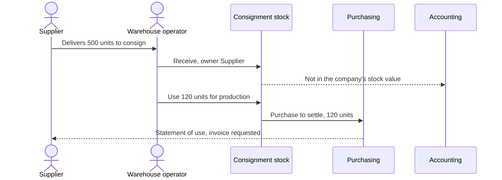

🏠 [Specs](../../../../README.md) › 🧩 [Functional capabilities](../../../README.md) ›
📦 [F7 Purchasing and stock](../../README.md) › 📝 [Use cases](../README.md) › 📝 UC-F7-25 Keep consignment stock

# 📝 UC-F7-25 Keep consignment stock

**Status:** 🔄 waiting for the owner

## Summary

Purchasing keeps consignment stock: goods a supplier leaves in the company's warehouse and keeps owning until the
company uses or sells them, and, the other way round, the company's goods held at a customer's site. Each quantity has
an owner, and the purchase or the sale happens only at use.

## Personas

- [U04 Purchasing and stock](../../../../01-users/personas/u04-purchasing.md)
- [U15 Warehouse operator](../../../../01-users/personas/u15-warehouse-operator.md)

## Goal

The company has the supplier's goods at hand without buying them in advance, and never counts them as its own stock or
pays for them before use.

## Trigger

A supplier agrees to consign goods, a delivery of consigned goods arrives, or consigned goods are used or returned.

## Frequency

A consignment agreement per supplier; deliveries and consumption weekly.

## Preconditions

- The supplier record exists with a consignment agreement
  ([E-F7-01 Supplier record](../../data/e-f07-01-supplier-record.md),
  [UC-F7-18](../07-supplier-agreements-and-performance/uc-f07-18-manage-supplier-contracts-and-price-agreements.md)).
- A consignment location exists in the warehouse ([E-F7-07 Location](../../data/e-f07-07-location.md),
  [UC-F7-13](../03-replenish/uc-f07-13-set-up-warehouses-routes-and-rules.md)).
- The items are in the catalogue ([E-F7-06 Item](../../data/e-f07-06-item.md)).

## Postconditions

- **Succeeded:** each consigned quantity has its owner ([E-F7-23 Stock owner](../../data/e-f07-23-stock-owner.md)); a
  use creates the purchase to settle and the stock movement; the consigned stock is outside the company's stock value.
- **Failed:** no quantity is moved or settled; the delivery waits in receiving.

## Main flow

1. The supplier delivers consigned goods; the warehouse operator receives them on the consignment screen
   ([S-F7-25](../../screens/10-consignment-scanning-and-edi/s-f07-25-consignment-stock.md)) and records the owner as the
   supplier.
2. simple-ERP stores them in the consignment location with the lot and the date, outside the company's stock value
   ([BR-F7-19](../../business-rules/br-f07-19-consigned-stock-is-never-valued-as-own-stock.md)).
3. A production order, a sale or a pick uses the goods; the quantity is consumed from the consigned stock first when the
   item is set to do so.
4. At each use simple-ERP creates the purchase obligation: a purchase order line or a self-billed invoice to settle, at
   the agreed price ([UC-F7-02](../01-procure/uc-f07-02-order-from-a-supplier.md)).
5. Purchasing reviews what is used, settles it with the supplier, and the supplier's invoice is matched
   ([UC-F7-04](../01-procure/uc-f07-04-capture-and-match-supplier-invoices.md)).
6. Unused or expired goods are returned to the supplier
   ([UC-F7-10](../04-pick-pack-and-ship/uc-f07-10-handle-returns-and-scrap.md)) and the owner's quantity falls.

## Alternative flows

- 1a. Consignment out: the company ships its own goods to a customer's site; the owner stays the company and the goods
  remain in the company's stock value, in a location of the customer.
- 3a. The consumption is reported monthly by the customer or the production line in a batch; the purchase obligation is
  created for the month.
- 6a. The count finds a difference between what the supplier says it left and what is on the shelf: it is handled as a
  count difference ([BR-F7-06](../../business-rules/br-f07-06-count-differences-need-approval.md)).

## Error flows

- 1e. The delivered quantity differs from the supplier's note: the receipt shows both and purchasing decides.
- 3e. Consigned stock is not enough: the use is refused or served from own stock, as the item says.
- 4e. The agreed price has expired
  ([BR-F7-11](../../business-rules/br-f07-11-contract-prices-apply-within-their-validity.md)): the obligation waits for
  purchasing to confirm the price.
- Any step: a service does not answer; the call is retried first
  ([BR-F3-32](../../../f03-assistant/business-rules/br-f03-32-retry-before-an-error.md)), then the message follows the
  error pattern ([D122](../../../../06-decisions/ux/d122-error-message-standard.md)) and what the user typed stays on
  the screen.

## Business rules

- [BR-F7-19](../../business-rules/br-f07-19-consigned-stock-is-never-valued-as-own-stock.md)
- [BR-F7-05 Every move is traced](../../business-rules/br-f07-05-every-move-is-traced.md)
- [BR-F7-07](../../business-rules/br-f07-07-costing-method-per-category.md)
- [BR-F7-10](../../business-rules/br-f07-10-third-party-stock-is-reconciled-daily.md)

## Entities

- [E-F7-23 Stock owner](../../data/e-f07-23-stock-owner.md): created, changed
- [E-F7-06 Item](../../data/e-f07-06-item.md): read, the item
- [E-F7-07 Location](../../data/e-f07-07-location.md): read, the consignment location
- [E-F7-01 Supplier record](../../data/e-f07-01-supplier-record.md): read, the supplier
- [E-F7-03 Purchase order](../../data/e-f07-03-purchase-order.md): created, the purchase to settle
- [E-F7-04 Transfer](../../data/e-f07-04-transfer.md): created, the movements

## Permissions

Purchasing manages agreements and settles; warehouse operators receive, store and consume. The accounting roles read the
consigned stock and never post it as own stock.

## Notifications

Purchasing, in the app: consigned goods used and waiting for settlement; consigned goods near expiry. The supplier: the
monthly statement of use.

## Audit events

Each receipt, use, return and settlement with the owner, quantity, lot, who and when.

## AI involvement

The AI assistant may propose which consigned lots to return (those near expiry or unused for a long time); purchasing
confirms.

## API, MCP and A2A exposure

T5 operations of the capability for the personas above: create, read, update and list. The MCP tool of the
capability may read and propose, never confirm alone. No A2A skill.

## Screens

- [S-F7-25](../../screens/10-consignment-scanning-and-edi/s-f07-25-consignment-stock.md)

## Flowchart

See
[FL-F7-10 Consignment, scanning, packaging and EDI](../../flows/fl-f07-10-consignment-scanning-and-edi.md#flowchart).

## Sequence diagram

## Acceptance criteria

1. **Given** 500 units received as consignment **when** stock is valued **then** none of them is in the company's stock
   value.
2. **Given** 120 consigned units used **when** the use is recorded **then** a purchase to settle for 120 units is
   created at the agreed price.
3. **Given** consigned goods near expiry **when** purchasing opens the screen **then** they are offered for return to
   the supplier.
4. **Given** goods consigned out to a customer **when** stock is valued **then** they stay in the company's stock value.

## Non-functional notes

The screen answers within 2 seconds for 10,000 records; every change is audited.

## Regulatory references

Consigned goods are not an asset of the company while the supplier owns them; stock valued and counted at year end only
covers what the company owns
([CR-FR-007](../../../../10-country-packs/france/accounting/cr-fr-007-annual-stock-count.md)). (Proposed) The
France-pack rule on consignment accounting is written later.

## Related use cases

- [UC-F7-26 Scan in the warehouse app](uc-f07-26-scan-in-the-warehouse-app.md)
- [UC-F7-16](../06-benchmark-additions/uc-f07-16-work-with-third-party-warehouses-and-channels.md)
- [UC-F7-09](../02-receive-and-store/uc-f07-09-value-stock-and-landed-costs.md)
- [UC-F7-03 Receive goods](../02-receive-and-store/uc-f07-03-receive-goods.md)

## Open questions

None.

---

⬅️ [UC-F7-24](../09-compliance-and-carbon/uc-f07-24-measure-the-carbon-of-purchases.md) · ⬆️ [Up](README.md) ·
➡️ [UC-F7-26 Scan in the warehouse app](uc-f07-26-scan-in-the-warehouse-app.md)
