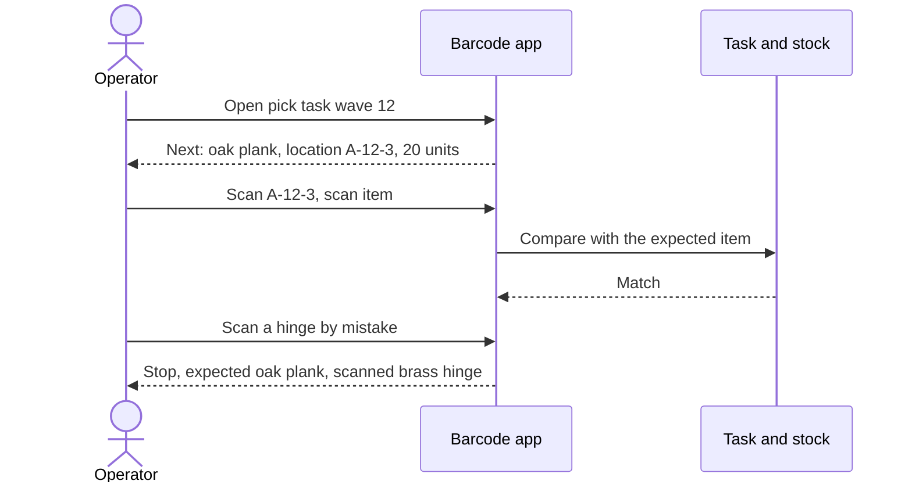

🏠 [Specs](../../../../README.md) › 🧩 [Functional capabilities](../../../README.md) ›
📦 [F7 Purchasing and stock](../../README.md) › 📝 [Use cases](../README.md) › 📝 UC-F7-26 Scan in the warehouse app

# 📝 UC-F7-26 Scan in the warehouse app

**Status:** ✅ specified

## Summary

Warehouse operators work on a phone with the camera or a scanner: they scan locations, items, lots and serials to
receive, put away, pick, pack, count and move, and each scan is checked against the item the step expects.

## Personas

- [U15 Warehouse operator](../../../../01-users/personas/u15-warehouse-operator.md)

## Goal

Every warehouse step is done on the right item, with the right lot, in the right place, without typing.

## Trigger

An operator starts a task on the phone: a receipt, a pick list, a count or a move.

## Frequency

Hundreds of scans a day per operator.

## Preconditions

- The operator is signed in on the phone with the warehouse app
  ([U15](../../../../01-users/personas/u15-warehouse-operator.md)).
- The task exists with the items it expects ([UC-F7-03](../02-receive-and-store/uc-f07-03-receive-goods.md),
  [UC-F7-06](../04-pick-pack-and-ship/uc-f07-06-pick-pack-and-ship.md),
  [UC-F7-07](../05-count-trace-and-analyse/uc-f07-07-count-stock.md)).
- Items carry a barcode or a code linked to them ([E-F7-06 Item](../../data/e-f07-06-item.md)).

## Postconditions

- **Succeeded:** each scan is recorded against its task with the item, the lot or serial, the quantity and the time; the
  stock moves are posted.
- **Failed:** the step does not advance; nothing is moved and the scan is shown as refused.

## Main flow

1. The operator opens the task on the barcode app
   ([S-F7-26](../../screens/10-consignment-scanning-and-edi/s-f07-26-barcode-app.md)): the next item, the quantity and
   the location are shown.
2. The operator scans the location and the item; for a lot or serial item, also the lot or serial.
3. SimpleERP compares the scan with what the step expects
   ([BR-F7-20](../../business-rules/br-f07-20-a-scan-that-does-not-match-the-expected-item-stops-the-step.md)); a match
   turns the line green.
4. The operator confirms the quantity, or scans each unit.
5. The step ends when every line is done; the stock moves are posted and the next task is offered.
6. The supervisor reads the day's scans and the refused ones from the office.

## Alternative flows

- 2a. The barcode is unreadable: the operator types the code or searches the item by name, and the entry is marked as
  typed.
- 2b. A scanner is paired with the phone: scans come from the scanner and the phone shows the result.
- 4a. The operator scans a different packaging unit (a box instead of a unit): the quantity is converted from the item's
  packaging.

## Error flows

- 3e. The scanned item is not the expected one: the step stops, the phone says so with the item scanned and the item
  expected, and the operator scans again or asks the supervisor
  ([BR-F7-20](../../business-rules/br-f07-20-a-scan-that-does-not-match-the-expected-item-stops-the-step.md)).
- 3f. The scanned lot is expired or blocked
  ([BR-F7-04](../../business-rules/br-f07-04-expiring-items-leave-first-expired-first.md)): the line is refused with the
  reason.
- 5e. The phone loses the network: the scans are kept on the phone and checked again when the network is back; a scan
  that no longer matches is refused then.
- Any step: a service does not answer; the call is retried first
  ([BR-F3-32](../../../f03-assistant/business-rules/br-f03-32-retry-before-an-error.md)), then the message follows the
  error pattern ([D122](../../../../06-decisions/ux/d122-error-message-standard.md)) and what the user typed stays on
  the screen.

## Business rules

- [BR-F7-20](../../business-rules/br-f07-20-a-scan-that-does-not-match-the-expected-item-stops-the-step.md)
- [BR-F7-05 Every move is traced](../../business-rules/br-f07-05-every-move-is-traced.md)
- [BR-F7-04](../../business-rules/br-f07-04-expiring-items-leave-first-expired-first.md)

## Entities

- [E-F7-06 Item](../../data/e-f07-06-item.md): read, the item behind the barcode
- [E-F7-04 Transfer](../../data/e-f07-04-transfer.md): changed, the moves of the task
- [E-F7-10 Lot or serial](../../data/e-f07-10-lot-or-serial.md): read, the lot or serial
- [E-F7-11 Stock count](../../data/e-f07-11-stock-count.md): changed, the counted quantity
- [E-F7-22 Delivery note](../../data/e-f07-22-delivery-note.md): changed, the picked and packed lines

## Permissions

Warehouse operators scan on their own tasks; the supervisor reads every scan and may override a refused scan with a
reason.

## Notifications

The operator, on the phone: a refused scan with its reason, the next task. The supervisor, in the app: more than 5
refused scans in an hour for one operator.

## Audit events

Every scan (code, item, lot, quantity, device, operator, time), every refused scan and why, every override with its
reason.

## AI involvement

No AI step. The AI assistant may answer "what is left to pick on wave 12?" from the open tasks.

## API, MCP and A2A exposure

T5 operations of F7 for the barcode app: list the operator's tasks, post a scan, confirm a line. The scan
endpoint answers within 300 ms. No MCP write tool; no A2A skill.

## Screens

- [S-F7-26](../../screens/10-consignment-scanning-and-edi/s-f07-26-barcode-app.md)

## Flowchart

See
[FL-F7-10 Consignment, scanning, packaging and EDI](../../flows/fl-f07-10-consignment-scanning-and-edi.md#flowchart).

## Sequence diagram

## Acceptance criteria

1. **Given** a pick line expecting the oak plank **when** the operator scans a brass hinge **then** the step stops and
   the phone shows the expected and the scanned item.
2. **Given** a pick line expecting the oak plank **when** the operator scans the oak plank **then** the line turns green
   and the quantity is asked.
3. **Given** a blocked lot **when** the operator scans it **then** the line is refused with the reason.
4. **Given** a phone without network **when** the operator keeps scanning **then** the scans are kept and checked when
   the network is back.

## Non-functional notes

A scan is answered within 300 ms on a normal network; the camera reads a barcode in under 1 second; scans
made offline are kept on the phone and sent when the network is back.

## Regulatory references

None specific beyond the traceability rule
([BR-F7-05 Every move is traced](../../business-rules/br-f07-05-every-move-is-traced.md)).

## Related use cases

- [UC-F7-25 Keep consignment stock](uc-f07-25-keep-consignment-stock.md)
- [UC-F7-27 Value stock periodically](uc-f07-27-value-stock-periodically.md)
- [UC-F7-03 Receive goods](../02-receive-and-store/uc-f07-03-receive-goods.md)
- [UC-F7-06 Pick, pack and ship](../04-pick-pack-and-ship/uc-f07-06-pick-pack-and-ship.md)
- [UC-F7-07 Count stock](../05-count-trace-and-analyse/uc-f07-07-count-stock.md)
- [UC-F7-30 Optimise storage locations](uc-f07-30-optimise-storage-locations.md)

## Open questions

None.

---

⬅️ [UC-F7-25 Keep consignment stock](uc-f07-25-keep-consignment-stock.md) · ⬆️ [Up](README.md) ·
➡️ [UC-F7-27 Value stock periodically](uc-f07-27-value-stock-periodically.md)
