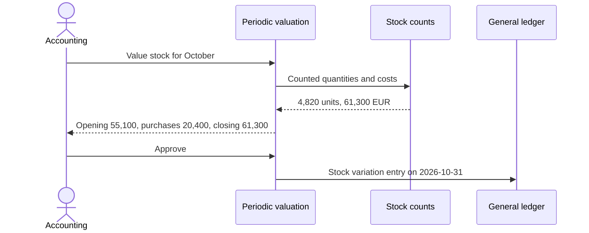

🏠 [Specs](../../../../README.md) › 🧩 [Functional capabilities](../../../README.md) ›
📦 [F7 Purchasing and stock](../../README.md) › 📝 [Use cases](../README.md) › 📝 UC-F7-27 Value stock periodically

# 📝 UC-F7-27 Value stock periodically

**Status:** ✅ specified

## Summary

Accounting values stock periodically for a company that does not track every movement at cost: at the end of each period
the counted stock is valued, the stock variation is computed from the opening stock, the purchases and the closing
stock, and one entry is posted.

## Personas

- [U05 Accounting](../../../../01-users/personas/u05-accounting.md)
- [U04 Purchasing and stock](../../../../01-users/personas/u04-purchasing.md)

## Goal

A simple company has an accurate stock value in its books each period without the effort of a perpetual valuation.

## Trigger

The end of a period, as the closing checklist reaches the stock step
[UC-F8-10](../../../f08-accounting/use-cases/05-close-report-and-consolidate/uc-f08-10-close-the-period-and-the-year.md).

## Frequency

Monthly or quarterly, and at year end.

## Preconditions

- The company chose the periodic method for the item categories
  ([BR-F7-07](../../business-rules/br-f07-07-costing-method-per-category.md)).
- A count is done at the end of the period ([UC-F7-07](../05-count-trace-and-analyse/uc-f07-07-count-stock.md),
  [E-F7-11 Stock count](../../data/e-f07-11-stock-count.md)).
- The period is open ([E-F8-10 Fiscal period](../../../f08-accounting/data/e-f08-10-fiscal-period.md)).

## Postconditions

- **Succeeded:** the period's count is valued ([E-F7-24 Periodic count](../../data/e-f07-24-periodic-count.md)) and one
  stock variation entry is posted at the period's end
  ([BR-F7-21](../../business-rules/br-f07-21-periodic-valuation-posts-only-at-period-end.md)).
- **Failed:** nothing is posted; the count stays Counted and the closing checklist shows the stock step as open.

## Main flow

1. Accounting opens the periodic valuation
   ([S-F7-27](../../screens/10-consignment-scanning-and-edi/s-f07-27-periodic-valuation.md)) at the end of the period.
2. SimpleERP shows the opening stock value, the purchases of the period and the counted quantities with their costs
   from the costing method of each category.
3. Purchasing confirms the count and the quantities of goods in transit and of consigned goods left out
   ([BR-F7-19](../../business-rules/br-f07-19-consigned-stock-is-never-valued-as-own-stock.md)).
4. SimpleERP computes the closing value and the stock variation: opening plus purchases minus closing.
5. Accounting reviews the figures per category and approves.
6. At the period's end SimpleERP posts one entry
   ([BR-F7-21](../../business-rules/br-f07-21-periodic-valuation-posts-only-at-period-end.md)), and the opening stock of
   the next period is the closing value.

## Alternative flows

- 2a. A category with a standard cost: the closing value uses it, and the price difference is shown separately.
- 5a. Accounting corrects a quantity: the count is changed with a reason and the valuation recomputed.
- 6a. The valuation is run again after a late invoice: the entry is reversed and posted again while the period is open.

## Error flows

- 4e. A counted item has no cost: the valuation stops for it and lists it for purchasing.
- 6e. The period is already locked ([BR-F8-02](../../../f08-accounting/business-rules/br-f08-02-lock-dates.md)): nothing
  is posted and the valuation is carried to the next open period.
- Any step: a service does not answer; the call is retried first
  ([BR-F3-32](../../../f03-assistant/business-rules/br-f03-32-retry-before-an-error.md)), then the message follows the
  error pattern ([D122](../../../../06-decisions/ux/d122-error-message-standard.md)) and what the user typed stays on
  the screen.

## Business rules

- [BR-F7-21](../../business-rules/br-f07-21-periodic-valuation-posts-only-at-period-end.md)
- [BR-F7-06](../../business-rules/br-f07-06-count-differences-need-approval.md)
- [BR-F8-02 Lock dates](../../../f08-accounting/business-rules/br-f08-02-lock-dates.md)
- [BR-F8-01](../../../f08-accounting/business-rules/br-f08-01-posted-entries-never-change.md)

## Entities

- [E-F7-24 Periodic count](../../data/e-f07-24-periodic-count.md): created, changed
- [E-F7-11 Stock count](../../data/e-f07-11-stock-count.md): read, the count
- [E-F8-10 Fiscal period](../../../f08-accounting/data/e-f08-10-fiscal-period.md): read, the period
- [E-F8-03 Journal entry](../../../f08-accounting/data/e-f08-03-journal-entry.md): created, the stock variation entry
- [E-F7-06 Item](../../data/e-f07-06-item.md): read, the cost of each item

## Permissions

Accounting values and approves; purchasing confirms the count; the owner reads the result.

## Notifications

Accounting, in the app: the count is ready to value; the period ends in 3 days with no valuation.

## Audit events

Each valuation (period, quantities, costs, totals), each correction, each entry posted and reversed, with who and when.

## AI involvement

The AI assistant explains the variation by category and flags counts far from the usual; accounting decides
([BR-F8-09](../../../f08-accounting/business-rules/br-f08-09-the-ai-proposes-people-post.md)).

## API, MCP and A2A exposure

T5 operations of the capability for the personas above: create, read, update and list. The MCP tool of the
capability may read and propose, never confirm alone. No A2A skill.

## Screens

- [S-F7-27](../../screens/10-consignment-scanning-and-edi/s-f07-27-periodic-valuation.md)

## Flowchart

See
[FL-F7-10 Consignment, scanning, packaging and EDI](../../flows/fl-f07-10-consignment-scanning-and-edi.md#flowchart).

## Sequence diagram

## Acceptance criteria

1. **Given** a count approved on 30 October **when** accounting approves the valuation **then** no entry is posted
   before the period's end.
2. **Given** opening stock 55,100 EUR, purchases 20,400 EUR and closing stock 61,300 EUR **when** the valuation is
   computed **then** the stock variation is a decrease of 14,200 EUR.
3. **Given** a counted item without a cost **when** the valuation runs **then** it stops for that item and lists it.
4. **Given** a locked period **when** the valuation is posted **then** it is refused and carried to the next open
   period.

## Non-functional notes

The screen answers within 2 seconds for 10,000 records; every change is audited.

## Regulatory references

Stock is counted and valued at least once a year:
[CR-FR-007](../../../../10-country-packs/france/accounting/cr-fr-007-annual-stock-count.md); posted entries are
inalterable: [CR-FR-003](../../../../10-country-packs/france/accounting/cr-fr-003-posted-entries-are-inalterable.md).

## Related use cases

- [UC-F7-26 Scan in the warehouse app](uc-f07-26-scan-in-the-warehouse-app.md)
- [UC-F7-28](uc-f07-28-track-returnable-packaging-and-deposits.md)
- [UC-F7-07 Count stock](../05-count-trace-and-analyse/uc-f07-07-count-stock.md)
- [UC-F7-09](../02-receive-and-store/uc-f07-09-value-stock-and-landed-costs.md)
- [UC-F8-10](../../../f08-accounting/use-cases/05-close-report-and-consolidate/uc-f08-10-close-the-period-and-the-year.md)

## Open questions

None.

---

⬅️ [UC-F7-26 Scan in the warehouse app](uc-f07-26-scan-in-the-warehouse-app.md) · ⬆️ [Up](README.md) ·
➡️ [UC-F7-28 Track returnable packaging and deposits](uc-f07-28-track-returnable-packaging-and-deposits.md)
