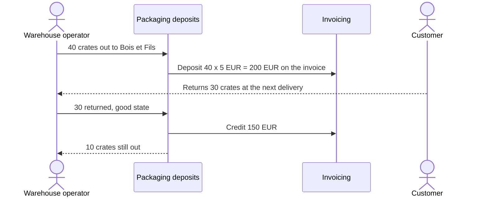

🏠 [Specs](../../../../README.md) › 🧩 [Functional capabilities](../../../README.md) ›
📦 [F7 Purchasing and stock](../../README.md) › 📝 [Use cases](../README.md) ›
📝 UC-F7-28 Track returnable packaging and deposits

# 📝 UC-F7-28 Track returnable packaging and deposits

**Status:** ✅ specified

## Summary

Purchasing and the warehouse track returnable packaging (pallets, crates, bottles, kegs): a deposit is charged to the
customer when packaging goes out, tracked per customer, and refunded when the packaging comes back; the same holds for
deposits the company pays to its suppliers.

## Personas

- [U04 Purchasing and stock](../../../../01-users/personas/u04-purchasing.md)
- [U15 Warehouse operator](../../../../01-users/personas/u15-warehouse-operator.md)

## Goal

The company knows how much packaging is out, at whom, and what deposit is held or owed, and refunds a deposit only for
packaging really returned.

## Trigger

A delivery with returnable packaging, a return of packaging, or a deposit statement.

## Frequency

With each delivery for companies that ship in returnable packaging; monthly statements.

## Preconditions

- The returnable packaging types and their unit deposit exist in the catalogue
  ([E-F7-06 Item](../../data/e-f07-06-item.md)).
- The customer or the supplier has an account
  ([E-F6-01 Customer record](../../../f06-customers-and-sales/data/e-f06-01-customer-record.md),
  [E-F7-01 Supplier record](../../data/e-f07-01-supplier-record.md)).
- The delivery or receipt is recorded ([E-F7-22 Delivery note](../../data/e-f07-22-delivery-note.md)).

## Postconditions

- **Succeeded:** each packaging movement is recorded on the deposit
  ([E-F7-25 Packaging deposit](../../data/e-f07-25-packaging-deposit.md)); a deposit invoice or credit is created; the
  balance of packaging and of deposit per party is known.
- **Failed:** no deposit is charged or refunded; the movement waits for a correction.

## Main flow

1. A delivery leaves with returnable packaging; the warehouse operator records the packaging on the delivery
   ([S-F7-28](../../screens/10-consignment-scanning-and-edi/s-f07-28-returnable-packaging.md)).
2. SimpleERP opens or updates the deposit of the customer: quantity out, unit deposit, amount charged on the invoice
   [UC-F6-06](../../../f06-customers-and-sales/use-cases/03-invoice-and-get-paid/uc-f06-06-invoice-deposits-progress-and-final.md).
3. The customer returns packaging at the next delivery or at the dock; the operator counts what is returned and records
   its state.
4. SimpleERP refunds the deposit for the quantity returned in good state only
   ([BR-F7-22](../../business-rules/br-f07-22-deposits-are-refunded-for-returned-items-only.md)) as a credit note or a
   credit on the account.
5. Purchasing reads the balance of packaging per customer and per supplier, and asks for what is overdue.
6. A deposit is closed when the packaging is back or written off.

## Alternative flows

- 3a. The packaging is returned by a carrier: the operator records it at the receipt and matches it to the customer.
- 4a. Packaging returned damaged: the refund is reduced as the deposit terms say, and the reason is recorded.
- 6a. Packaging lost and agreed by the customer: the deposit is kept as income and the packaging is written off.

## Error flows

- 3e. More packaging is returned than was out: the surplus is held aside and purchasing decides.
- 4e. A refund for a quantity above the returns: refused
  ([BR-F7-22](../../business-rules/br-f07-22-deposits-are-refunded-for-returned-items-only.md)).
- 5e. A supplier's deposit is invoiced with no matching packaging out: the invoice is held for purchasing.
- Any step: a service does not answer; the call is retried first
  ([BR-F3-32](../../../f03-assistant/business-rules/br-f03-32-retry-before-an-error.md)), then the message follows the
  error pattern ([D122](../../../../06-decisions/ux/d122-error-message-standard.md)) and what the user typed stays on
  the screen.

## Business rules

- [BR-F7-22](../../business-rules/br-f07-22-deposits-are-refunded-for-returned-items-only.md)
- [BR-F7-05 Every move is traced](../../business-rules/br-f07-05-every-move-is-traced.md)
- [BR-F6-08](../../../f06-customers-and-sales/business-rules/br-f06-08-vat-is-shown-wherever-it-matters.md)

## Entities

- [E-F7-25 Packaging deposit](../../data/e-f07-25-packaging-deposit.md): created, changed
- [E-F6-05 Invoice](../../../f06-customers-and-sales/data/e-f06-05-invoice.md): created, the deposit line and the credit
- [E-F7-22 Delivery note](../../data/e-f07-22-delivery-note.md): read, the packaging on delivery
- [E-F7-06 Item](../../data/e-f07-06-item.md): read, the packaging type

## Permissions

Purchasing and the warehouse manage deposits; sales and accounting read them; a customer reads its own balance in the
portal ([BR-F6-03](../../../f06-customers-and-sales/business-rules/br-f06-03-portal-shows-only-the-customer-s-own.md)).

## Notifications

Purchasing, in the app: a customer holding packaging beyond the agreed time. The customer: its deposit statement,
monthly.

## Audit events

Each packaging out, return and write-off with the party, quantity, state, deposit amount, who and when.

## AI involvement

No AI step of its own; the AI assistant may list the customers holding the most packaging.

## API, MCP and A2A exposure

T5 operations of the capability for the personas above: create, read, update and list. The MCP tool of the
capability may read and propose, never confirm alone. No A2A skill.

## Screens

- [S-F7-28](../../screens/10-consignment-scanning-and-edi/s-f07-28-returnable-packaging.md)

## Flowchart

See
[FL-F7-10 Consignment, scanning, packaging and EDI](../../flows/fl-f07-10-consignment-scanning-and-edi.md#flowchart).

## Sequence diagram

## Acceptance criteria

1. **Given** 40 crates delivered with a 5 EUR deposit **when** the invoice is issued **then** a deposit of 200 EUR is
   charged.
2. **Given** 30 of the 40 crates returned in good state **when** the return is recorded **then** 150 EUR is refunded and
   10 crates remain out.
3. **Given** a refund for 35 crates when 30 are returned **when** it is entered **then** it is refused.
4. **Given** damaged crates returned **when** the return is recorded **then** the refund follows the deposit terms and
   the reason is saved.

## Non-functional notes

The screen answers within 2 seconds for 10,000 records; every change is audited.

## Regulatory references

The VAT treatment of deposits follows the country pack and is shown on the invoice:
[BR-F6-08](../../../f06-customers-and-sales/business-rules/br-f06-08-vat-is-shown-wherever-it-matters.md).
The France-pack rule on deposits is [CR-FR-281 VAT on deposits for returnable packaging](../../../../10-country-packs/france/tax-and-vat/cr-fr-281-vat-on-returnable-packaging-deposits.md).

## Related use cases

- [UC-F7-27 Value stock periodically](uc-f07-27-value-stock-periodically.md)
- [UC-F7-29](uc-f07-29-exchange-orders-and-invoices-by-edi-with-suppliers.md)
- [UC-F7-03 Receive goods](../02-receive-and-store/uc-f07-03-receive-goods.md)
- [UC-F7-06 Pick, pack and ship](../04-pick-pack-and-ship/uc-f07-06-pick-pack-and-ship.md)
- [UC-F6-09](../../../f06-customers-and-sales/use-cases/03-invoice-and-get-paid/uc-f06-09-credit-note-and-refund.md)

## Open questions

None.

---

⬅️ [UC-F7-27 Value stock periodically](uc-f07-27-value-stock-periodically.md) · ⬆️ [Up](README.md) ·
➡️ [UC-F7-29](uc-f07-29-exchange-orders-and-invoices-by-edi-with-suppliers.md)
