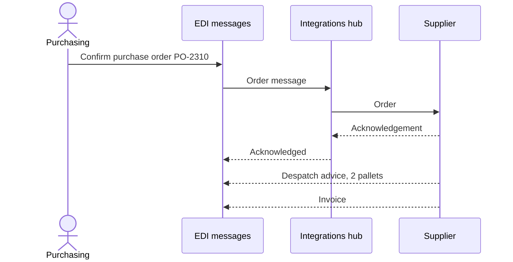

🏠 [Specs](../../../../README.md) › 🧩 [Functional capabilities](../../../README.md) ›
📦 [F7 Purchasing and stock](../../README.md) › 📝 [Use cases](../README.md) ›
📝 UC-F7-29 Exchange orders and invoices by EDI with suppliers

# 📝 UC-F7-29 Exchange orders and invoices by EDI with suppliers

**Status:** ✅ specified

## Summary

Purchasing exchanges orders, order responses, despatch advices and invoices with suppliers by EDI instead of email,
through the integrations hub; every message is acknowledged or sent again, and errors are visible per message.

## Personas

- [U04 Purchasing and stock](../../../../01-users/personas/u04-purchasing.md)

## Goal

Large suppliers receive the company's orders and confirm them without anyone retyping, and nothing is lost between the
two systems.

## Trigger

A purchase order is confirmed for a supplier with EDI, or a message arrives from the supplier.

## Frequency

Every order to an EDI supplier; despatch advices and invoices as the supplier sends them.

## Preconditions

- The supplier has an EDI agreement with its identifiers and message formats
  ([E-F7-01 Supplier record](../../data/e-f07-01-supplier-record.md),
  [E-F6-24](../../../f06-customers-and-sales/data/e-f06-24-company-identifier.md)).
- The EDI connector is set up in the integrations hub
  [UC-F24-02](../../../f24-integrations-hub/use-cases/01-find-and-connect/uc-f24-02-connect-a-tool-in-the-fewest-steps.md).
- The purchase order is confirmed ([E-F7-03 Purchase order](../../data/e-f07-03-purchase-order.md)).

## Postconditions

- **Succeeded:** each message is recorded ([E-F7-26 EDI message](../../data/e-f07-26-edi-message.md)) with its state; an
  acknowledged order is confirmed; a received despatch advice prepares the receipt; a received invoice goes to matching.
- **Failed:** a message that cannot be delivered or read is Failed or Rejected with its reason, and the order is not
  treated as confirmed.

## Main flow

1. Purchasing confirms a purchase order for an EDI supplier; SimpleERP builds the order message from it
   ([S-F7-29 Supplier EDI](../../screens/10-consignment-scanning-and-edi/s-f07-29-supplier-edi.md)).
2. The message is sent through the connector and recorded as Sent.
3. The supplier answers with an acknowledgement and an order response (accepted, changed, refused); the message becomes
   Acknowledged ([BR-F7-23](../../business-rules/br-f07-23-edi-messages-are-acknowledged-or-retried.md)).
4. A change of quantity, price or date in the response is shown to purchasing, who accepts or negotiates.
5. The supplier sends a despatch advice before shipping; the warehouse prepares the receipt
   ([UC-F7-03](../02-receive-and-store/uc-f07-03-receive-goods.md)).
6. The supplier sends an invoice by EDI; it is read and goes to matching
   ([UC-F7-04](../01-procure/uc-f07-04-capture-and-match-supplier-invoices.md)).

## Alternative flows

- 3a. No acknowledgement in the agreed time: the message is sent again, up to the agreed number of times, then fails.
- 5a. A despatch advice with a pallet and parcel structure: the receipt expects each unit by its code.
- 6a. An invoice for a French supplier or customer is not exchanged by EDI: it goes through the company's e-invoicing
  platform ([D454](../../../../06-decisions/f08-accounting/d454-e-invoicing-platforms.md)).

## Error flows

- 2e. The connector is down: the message stays Queued and is sent when it is back.
- 3e. The supplier rejects the message as unreadable: it is Rejected with the supplier's reason; purchasing corrects and
  resends.
- 6e. An incoming message cannot be read (unknown item code): it is Rejected and listed for purchasing.
- Any step: a service does not answer; the call is retried first
  ([BR-F3-32](../../../f03-assistant/business-rules/br-f03-32-retry-before-an-error.md)), then the message follows the
  error pattern ([D122](../../../../06-decisions/ux/d122-error-message-standard.md)) and what the user typed stays on
  the screen.

## Business rules

- [BR-F7-23](../../business-rules/br-f07-23-edi-messages-are-acknowledged-or-retried.md)
- [BR-F7-03](../../business-rules/br-f07-03-supplier-invoices-are-matched.md)

## Entities

- [E-F7-26 EDI message](../../data/e-f07-26-edi-message.md): created, changed
- [E-F7-03 Purchase order](../../data/e-f07-03-purchase-order.md): changed, confirmed or changed by the response
- [E-F7-01 Supplier record](../../data/e-f07-01-supplier-record.md): read, the EDI agreement
- [E-F7-05 Supplier invoice](../../data/e-f07-05-supplier-invoice.md): created, an invoice read from EDI
- [E-F7-22 Delivery note](../../data/e-f07-22-delivery-note.md): created, an expected receipt

## Permissions

Purchasing reads and resends messages; the administrator sets up the connector; accounting reads the invoices received.

## Notifications

Purchasing, in the app: a message failed after its last try, a response that changes the order. Warehouse: a despatch
advice arrived.

## Audit events

Every message with its direction, type, reference, size, state changes, tries and who resent it.

## AI involvement

The AI assistant may map an unknown supplier code to an item and propose it; purchasing confirms.

## API, MCP and A2A exposure

T5 operations of the capability for the personas above: create, read, update and list. The MCP tool of the
capability may read and propose, never confirm alone. No A2A skill.

## Screens

- [S-F7-29 Supplier EDI](../../screens/10-consignment-scanning-and-edi/s-f07-29-supplier-edi.md)

## Flowchart

See
[FL-F7-10 Consignment, scanning, packaging and EDI](../../flows/fl-f07-10-consignment-scanning-and-edi.md#flowchart).

## Sequence diagram

## Acceptance criteria

1. **Given** a purchase order sent by EDI **when** no acknowledgement arrives within the agreed time **then** the
   message is sent again and the order is not treated as confirmed.
2. **Given** an order message sent 3 times with no answer **when** the last try fails **then** the message is Failed and
   purchasing is notified.
3. **Given** an order response that changes the quantity **when** it is received **then** purchasing sees the change and
   accepts or negotiates.
4. **Given** an invoice received by EDI **when** it is read **then** it goes to matching like any supplier invoice.

## Non-functional notes

The screen answers within 2 seconds for 10,000 records; every change is audited.

## Regulatory references

Invoices exchanged with French parties go through the company's approved platforms:
[D454](../../../../06-decisions/f08-accounting/d454-e-invoicing-platforms.md); EDI covers the orders and logistics
messages.

## Related use cases

- [UC-F7-28](uc-f07-28-track-returnable-packaging-and-deposits.md)
- [UC-F7-30 Optimise storage locations](uc-f07-30-optimise-storage-locations.md)
- [UC-F7-02 Order from a supplier](../01-procure/uc-f07-02-order-from-a-supplier.md)
- [UC-F7-04](../01-procure/uc-f07-04-capture-and-match-supplier-invoices.md)
- [UC-F7-03 Receive goods](../02-receive-and-store/uc-f07-03-receive-goods.md)
- [UC-F7-18](../07-supplier-agreements-and-performance/uc-f07-18-manage-supplier-contracts-and-price-agreements.md)

## Open questions

None.

---

⬅️ [UC-F7-28 Track returnable packaging and deposits](uc-f07-28-track-returnable-packaging-and-deposits.md) ·
⬆️ [Up](README.md) · ➡️ [UC-F7-30 Optimise storage locations](uc-f07-30-optimise-storage-locations.md)
