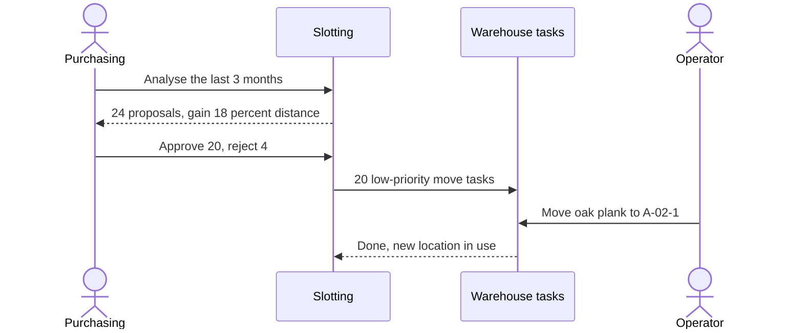

🏠 [Specs](../../../../README.md) › 🧩 [Functional capabilities](../../../README.md) ›
📦 [F7 Purchasing and stock](../../README.md) › 📝 [Use cases](../README.md) › 📝 UC-F7-30 Optimise storage locations

# 📝 UC-F7-30 Optimise storage locations

**Status:** ✅ specified

## Summary

Purchasing and the warehouse optimise storage locations: SimpleERP analyses how often each item is picked, its size,
its weight and the items picked together, proposes better locations, and turns approved proposals into move tasks for
the warehouse operators.

## Personas

- [U04 Purchasing and stock](../../../../01-users/personas/u04-purchasing.md)
- [U15 Warehouse operator](../../../../01-users/personas/u15-warehouse-operator.md)

## Goal

Fast movers sit near the dock, heavy goods low and items picked together close, so that picking is shorter and safer.

## Trigger

A scheduled analysis (monthly), a new range of items, or the planner's request.

## Frequency

Monthly analysis; a few dozen proposals a run.

## Preconditions

- The warehouse's locations and their capacities exist ([E-F7-07 Location](../../data/e-f07-07-location.md),
  [UC-F7-13](../03-replenish/uc-f07-13-set-up-warehouses-routes-and-rules.md)).
- Pick history exists for at least 3 months ([UC-F7-06](../04-pick-pack-and-ship/uc-f07-06-pick-pack-and-ship.md),
  [UC-F7-11](../05-count-trace-and-analyse/uc-f07-11-analyse-stock.md)).
- Item sizes and weights are known ([E-F7-06 Item](../../data/e-f07-06-item.md)).

## Postconditions

- **Succeeded:** each proposal is recorded ([E-F7-27 Slotting proposal](../../data/e-f07-27-slotting-proposal.md)) with
  its reason and its expected gain; approved proposals become transfers and are done by the operators
  ([E-F7-04 Transfer](../../data/e-f07-04-transfer.md)).
- **Failed:** no location changes; the proposals stay for review.

## Main flow

1. Purchasing runs the analysis on the slotting screen
   ([S-F7-30 Slotting](../../screens/10-consignment-scanning-and-edi/s-f07-30-slotting.md)), or it runs on its schedule.
2. SimpleERP scores each item by picks per month, volume, weight and the items it is picked with.
3. It proposes moves from a location to a better one, each with its reason (faster access, lower weight, together with a
   partner item) and the expected gain in picking distance.
4. Purchasing approves, changes or rejects each proposal.
5. Approved proposals become move tasks of low priority for the warehouse operators
   ([BR-F7-24](../../business-rules/br-f07-24-re-slotting-tasks-never-block-open-picks.md)).
6. The operators move the goods by scanning ([UC-F7-26](uc-f07-26-scan-in-the-warehouse-app.md)); the proposal is Done
   and the new location is used for the next picks.

## Alternative flows

- 2a. Purchasing excludes items (hazardous goods, items in a fixed zone): they are never proposed.
- 4a. Purchasing runs the proposals as a batch and chooses the day of the moves.
- 6a. The operator finds the destination full: the move waits and the proposal is re-evaluated.

## Error flows

- 3e. A proposal would put goods in a location that cannot hold them (weight, hazard, temperature): it is not proposed.
- 5e. A pick needs the item or the location of a move: the move is postponed, never the pick
  ([BR-F7-24](../../business-rules/br-f07-24-re-slotting-tasks-never-block-open-picks.md)).
- 6f. The goods are not where the system says: the move becomes a count difference
  ([BR-F7-06](../../business-rules/br-f07-06-count-differences-need-approval.md)).
- Any step: a service does not answer; the call is retried first
  ([BR-F3-32](../../../f03-assistant/business-rules/br-f03-32-retry-before-an-error.md)), then the message follows the
  error pattern ([D122](../../../../06-decisions/ux/d122-error-message-standard.md)) and what the user typed stays on
  the screen.

## Business rules

- [BR-F7-24](../../business-rules/br-f07-24-re-slotting-tasks-never-block-open-picks.md)
- [BR-F7-05 Every move is traced](../../business-rules/br-f07-05-every-move-is-traced.md)
- [BR-F7-08 No negative stock](../../business-rules/br-f07-08-no-negative-stock.md)

## Entities

- [E-F7-27 Slotting proposal](../../data/e-f07-27-slotting-proposal.md): created, changed
- [E-F7-07 Location](../../data/e-f07-07-location.md): read, the locations and their capacity
- [E-F7-06 Item](../../data/e-f07-06-item.md): read, the item data
- [E-F7-04 Transfer](../../data/e-f07-04-transfer.md): created, the move task

## Permissions

Purchasing and the warehouse manager run the analysis and approve; operators execute the moves.

## Notifications

Purchasing, in the app: the analysis has produced proposals. Operators, on the phone: the move tasks of the day, after
the picks.

## Audit events

Each analysis run (period, items, parameters), each proposal's decision, who and when, each move done.

## AI involvement

The AI assistant explains each proposal in words and may suggest exclusions; it never approves or moves anything.

## API, MCP and A2A exposure

T5 operations of the capability for the personas above: create, read, update and list. The MCP tool of the
capability may read and propose, never confirm alone. No A2A skill.

## Screens

- [S-F7-30 Slotting](../../screens/10-consignment-scanning-and-edi/s-f07-30-slotting.md)

## Flowchart

See
[FL-F7-10 Consignment, scanning, packaging and EDI](../../flows/fl-f07-10-consignment-scanning-and-edi.md#flowchart).

## Sequence diagram

## Acceptance criteria

1. **Given** an item picked 300 times a month in a far location **when** the analysis runs **then** a proposal moves it
   near the dock with its reason and gain.
2. **Given** an approved move and an open pick that needs the same location **when** both are due **then** the pick goes
   first and the move is postponed.
3. **Given** a heavy item proposed for a top shelf **when** the analysis runs **then** it is not proposed.
4. **Given** a proposal rejected **when** the next analysis runs **then** the same proposal is not offered again for 3
   months.

## Non-functional notes

The screen answers within 2 seconds for 10,000 records; every change is audited.

## Regulatory references

None specific beyond storage safety rules for hazardous goods
([BR-F7-08](../../business-rules/br-f07-08-no-negative-stock.md)).

## Related use cases

- [UC-F7-29](uc-f07-29-exchange-orders-and-invoices-by-edi-with-suppliers.md)
- [UC-F7-13](../03-replenish/uc-f07-13-set-up-warehouses-routes-and-rules.md)
- [UC-F7-06 Pick, pack and ship](../04-pick-pack-and-ship/uc-f07-06-pick-pack-and-ship.md)
- [UC-F7-26 Scan in the warehouse app](uc-f07-26-scan-in-the-warehouse-app.md)
- [UC-F7-11 Analyse stock](../05-count-trace-and-analyse/uc-f07-11-analyse-stock.md)

## Open questions

None.

---

⬅️ [UC-F7-29](uc-f07-29-exchange-orders-and-invoices-by-edi-with-suppliers.md) · ⬆️ [Up](README.md)
