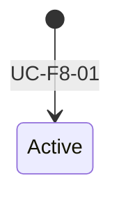

🏠 [Specs](../../../README.md) › 🧩 [Functional capabilities](../../README.md) › 📒 [F8 Accounting](../README.md) ›
🗃️ [Data](README.md) › 🗃️ E-F8-01 Account

# 🗃️ E-F8-01 Account

**Status:** ✅ specified

## Purpose

An account of the chart.

## Fields

| Name | Type | Required | Validation | Default | Example | Personal data | Custom fields |
|---|---|---|---|---|---|---|---|
| code | text | yes | unique | - | 411000 | no | no |
| name | text | yes | - | - | Customers | no | no |
| type | asset, liability, equity, income, expense | yes | - | - | asset | no | no |
| reconcilable | yes or no | yes | - | no | yes | no | no |

## Relations

As its use cases.

## Lifecycle

## Indexes and search

By number, date, partner.

## Retention

Accounting documents 10 years (Code de commerce L123-22). See
[CR-FR-002 Accounting records kept 10 years](../../../10-country-packs/france/accounting/cr-fr-002-accounting-records-kept-ten-years.md).

## Audit

Every change.

## Import and export

CSV, FEC where relevant.

## Used by

- [UC-F8-01](../use-cases/01-set-up-and-post/uc-f08-01-set-up-the-books.md)
- [UC-F8-11](../use-cases/05-close-report-and-consolidate/uc-f08-11-read-financial-reports.md)

## Open questions

None.

---

⬆️ [Up](README.md) · ➡️ [E-F8-02 Journal](e-f08-02-journal.md)
