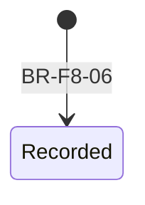

🏠 [Specs](../../../README.md) › 🧩 [Functional capabilities](../../README.md) › 📒 [F8 Accounting](../README.md) ›
🗃️ [Data](README.md) › 🗃️ E-F8-02 Journal

# 🗃️ E-F8-02 Journal

**Status:** ✅ specified

## Purpose

A journal of entries.

## Fields

| Name | Type | Required | Validation | Default | Example | Personal data | Custom fields |
|---|---|---|---|---|---|---|---|
| code | text | yes | 1 to 5 characters | - | VTE | no | no |
| type | sales, purchases, bank, cash, miscellaneous | yes | - | - | sales | no | no |
| sequence | text | yes | continuous per year (BR-F8-06) | - | VTE/2026/00412 | no | no |

## Relations

As its use cases.

## Lifecycle

## Indexes and search

By number, date, partner.

## Retention

Accounting documents 10 years (Code de commerce L123-22). See
[CR-FR-002 Accounting records kept 10 years](../../../10-country-packs/france/accounting/cr-fr-002-accounting-records-kept-ten-years.md).

## Audit

Every change.

## Import and export

CSV, FEC where relevant.

## Used by

- [UC-F8-01](../use-cases/01-set-up-and-post/uc-f08-01-set-up-the-books.md)
- [UC-F8-14](../use-cases/01-set-up-and-post/uc-f08-14-work-with-the-external-accountant.md)

## Open questions

None.

---

⬅️ [E-F8-01 Account](e-f08-01-account.md) · ⬆️ [Up](README.md) · ➡️ [E-F8-03 Journal entry](e-f08-03-journal-entry.md)
