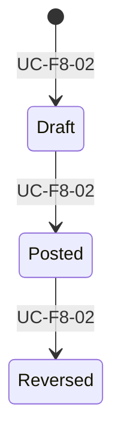

🏠 [Specs](../../../README.md) › 🧩 [Functional capabilities](../../README.md) › 📒 [F8 Accounting](../README.md) ›
🗃️ [Data](README.md) › 🗃️ E-F8-03 Journal entry

# 🗃️ E-F8-03 Journal entry

**Status:** ✅ specified

## Purpose

A balanced accounting entry.

## Fields

| Name | Type | Required | Validation | Default | Example | Personal data | Custom fields |
|---|---|---|---|---|---|---|---|
| number | text | yes | BR-F8-06 | sequence | VTE/2026/00412 | no | no |
| date | date | yes | not in a locked period (BR-F8-02) | - | 2026-11-10 | no | no |
| lines | list of account, partner, debit, credit, analytic, tax | yes | balanced | - | 411000 debit 58,567.20 | no | no |
| state | draft, posted, reversed | yes | BR-F8-01 | draft | posted | no | no |
| hash | text | when posted | chained | - | 3f9a... | no | no |

## Relations

As its use cases.

## Lifecycle

## Indexes and search

By number, date, partner.

## Retention

Accounting documents 10 years (Code de commerce L123-22). See
[CR-FR-002 Accounting records kept 10 years](../../../10-country-packs/france/accounting/cr-fr-002-accounting-records-kept-ten-years.md).

## Audit

Every change.

## Import and export

CSV, FEC where relevant.

## Used by

- [UC-F8-02](../use-cases/01-set-up-and-post/uc-f08-02-post-and-review-entries.md)
- [UC-F8-03](../use-cases/02-purchase-to-pay/uc-f08-03-process-supplier-bills.md)
- [UC-F8-11](../use-cases/05-close-report-and-consolidate/uc-f08-11-read-financial-reports.md)
- [UC-F8-14](../use-cases/01-set-up-and-post/uc-f08-14-work-with-the-external-accountant.md)
- [UC-F8-26 Provision doubtful debts](../use-cases/08-year-end-duties/uc-f08-26-provision-doubtful-debts.md)
- [UC-F8-29 Answer the accountant's questions and requests](../use-cases/10-accountant-collaboration/uc-f08-29-answer-the-accountants-questions-and-requests.md)

## Open questions

None.

---

⬅️ [E-F8-02 Journal](e-f08-02-journal.md) · ⬆️ [Up](README.md) · ➡️ [E-F8-04 Bank line](e-f08-04-bank-line.md)
