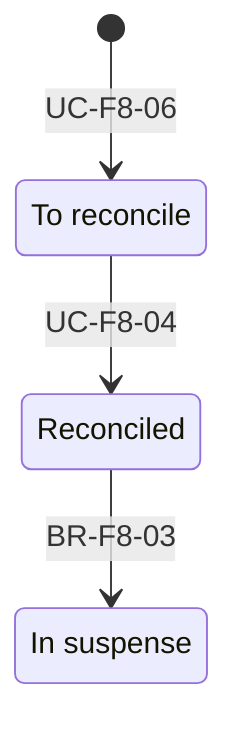

🏠 [Specs](../../../README.md) › 🧩 [Functional capabilities](../../README.md) › 📒 [F8 Accounting](../README.md) ›
🗃️ [Data](README.md) › 🗃️ E-F8-04 Bank line

# 🗃️ E-F8-04 Bank line

**Status:** ✅ specified

## Purpose

A line of a bank statement.

## Fields

| Name | Type | Required | Validation | Default | Example | Personal data | Custom fields |
|---|---|---|---|---|---|---|---|
| account | bank account | yes | - | - | Crédit Agricole ...4521 | no | no |
| date, amount, label | values | yes | - | - | 2026-11-12, 14,641.80, VIR DURAND SA F-2026-0512 | maybe | no |
| source | aggregator, file | yes | - | - | aggregator | no | no |
| state | to reconcile, reconciled, in suspense | yes | BR-F8-03 | to reconcile | reconciled | no | no |

## Relations

As its use cases.

## Lifecycle

## Indexes and search

By number, date, partner.

## Retention

Accounting documents 10 years (Code de commerce L123-22). See
[CR-FR-002 Accounting records kept 10 years](../../../10-country-packs/france/accounting/cr-fr-002-accounting-records-kept-ten-years.md).

## Audit

Every change.

## Import and export

CSV, FEC where relevant.

## Used by

- [UC-F8-04](../use-cases/02-purchase-to-pay/uc-f08-04-pay-suppliers.md)
- [UC-F8-05](../use-cases/03-bank-and-collect/uc-f08-05-collect-customer-payments.md)
- [UC-F8-06](../use-cases/03-bank-and-collect/uc-f08-06-connect-banks-and-reconcile.md)
- [UC-F8-21 Keep third-party client money](../use-cases/07-client-money-grants-and-non-profits/uc-f08-21-keep-third-party-client-money.md)

## Open questions

None.

---

⬅️ [E-F8-03 Journal entry](e-f08-03-journal-entry.md) · ⬆️ [Up](README.md) ·
➡️ [E-F8-05 Reconciliation model](e-f08-05-reconciliation-model.md)
