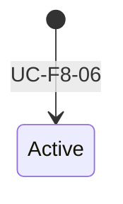

🏠 [Specs](../../../README.md) › 🧩 [Functional capabilities](../../README.md) › 📒 [F8 Accounting](../README.md) ›
🗃️ [Data](README.md) › 🗃️ E-F8-05 Reconciliation model

# 🗃️ E-F8-05 Reconciliation model

**Status:** ✅ specified

## Purpose

A rule matching or writing bank lines.

## Fields

| Name | Type | Required | Validation | Default | Example | Personal data | Custom fields |
|---|---|---|---|---|---|---|---|
| name | text | yes | - | - | Card fees | no | no |
| conditions | label, partner, amount, regex | yes | - | - | label contains FRAIS CB | no | no |
| action | match invoices, write an entry | yes | - | - | entry 627000 | no | no |
| auto-validate | yes or no | yes | - | no | yes | no | no |

## Relations

As its use cases.

## Lifecycle

## Indexes and search

By number, date, partner.

## Retention

Accounting documents 10 years (Code de commerce L123-22). See
[CR-FR-002 Accounting records kept 10 years](../../../10-country-packs/france/accounting/cr-fr-002-accounting-records-kept-ten-years.md).

## Audit

Every change.

## Import and export

CSV, FEC where relevant.

## Used by

- [UC-F8-06](../use-cases/03-bank-and-collect/uc-f08-06-connect-banks-and-reconcile.md)

## Open questions

None.

---

⬅️ [E-F8-04 Bank line](e-f08-04-bank-line.md) · ⬆️ [Up](README.md) · ➡️ [E-F8-06 Tax return](e-f08-06-tax-return.md)
