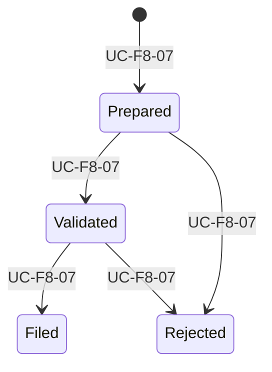

🏠 [Specs](../../../README.md) › 🧩 [Functional capabilities](../../README.md) › 📒 [F8 Accounting](../README.md) ›
🗃️ [Data](README.md) › 🗃️ E-F8-06 Tax return

# 🗃️ E-F8-06 Tax return

**Status:** ✅ specified

## Purpose

A VAT or other tax return.

## Fields

| Name | Type | Required | Validation | Default | Example | Personal data | Custom fields |
|---|---|---|---|---|---|---|---|
| kind | CA3, CA12, DAS2, OSS, Intrastat, liasse fiscale | yes | - | - | CA3 | no | no |
| period | dates | yes | - | - | October 2026 | no | no |
| state | prepared, validated, filed, rejected | yes | BR-F8-04 | prepared | filed | no | no |
| receipt | file | when filed | - | - | EDI acknowledgement | no | no |

## Relations

As its use cases.

## Lifecycle

## Indexes and search

By number, date, partner.

## Retention

Accounting documents 10 years (Code de commerce L123-22). See
[CR-FR-002 Accounting records kept 10 years](../../../10-country-packs/france/accounting/cr-fr-002-accounting-records-kept-ten-years.md).

## Audit

Every change.

## Import and export

CSV, FEC where relevant.

## Used by

- [UC-F8-03](../use-cases/02-purchase-to-pay/uc-f08-03-process-supplier-bills.md)
- [UC-F8-07](../use-cases/04-tax-assets-and-analytics/uc-f08-07-manage-vat-and-file-returns.md)
- [UC-F8-24 Compute and pay corporate tax and local business taxes](../use-cases/08-year-end-duties/uc-f08-24-compute-and-pay-corporate-tax-and-local-business-taxes.md)

## Open questions

None.

---

⬅️ [E-F8-05 Reconciliation model](e-f08-05-reconciliation-model.md) · ⬆️ [Up](README.md) ·
➡️ [E-F8-07 Fixed asset](e-f08-07-fixed-asset.md)
