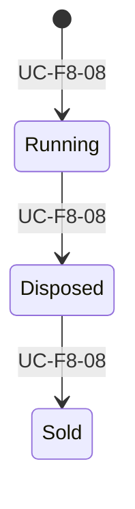

🏠 [Specs](../../../README.md) › 🧩 [Functional capabilities](../../README.md) › 📒 [F8 Accounting](../README.md) ›
🗃️ [Data](README.md) › 🗃️ E-F8-07 Fixed asset

# 🗃️ E-F8-07 Fixed asset

**Status:** ✅ specified

## Purpose

An asset and its depreciation.

## Fields

| Name | Type | Required | Validation | Default | Example | Personal data | Custom fields |
|---|---|---|---|---|---|---|---|
| name | text | yes | - | - | Van Renault Master | no | no |
| value | money | yes | - | - | 32,000 EUR excl. VAT | no | no |
| method | straight line, declining, declining then straight | yes | - | straight line | straight line | no | no |
| duration | months | yes | - | - | 60 | no | no |
| state | running, disposed, sold | yes | - | running | running | no | no |

## Relations

As its use cases.

## Lifecycle

## Indexes and search

By number, date, partner.

## Retention

Accounting documents 10 years (Code de commerce L123-22). See
[CR-FR-002 Accounting records kept 10 years](../../../10-country-packs/france/accounting/cr-fr-002-accounting-records-kept-ten-years.md).

## Audit

Every change.

## Import and export

CSV, FEC where relevant.

## Used by

- [UC-F8-08](../use-cases/04-tax-assets-and-analytics/uc-f08-08-manage-fixed-assets-and-deferrals.md)
- [UC-F8-22 Account for a grant](../use-cases/07-client-money-grants-and-non-profits/uc-f08-22-account-for-a-grant.md)

## Open questions

None.

---

⬅️ [E-F8-06 Tax return](e-f08-06-tax-return.md) · ⬆️ [Up](README.md) ·
➡️ [E-F8-08 Accounting budget](e-f08-08-accounting-budget.md)
