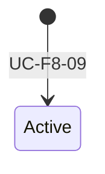

🏠 [Specs](../../../README.md) › 🧩 [Functional capabilities](../../README.md) › 📒 [F8 Accounting](../README.md) ›
🗃️ [Data](README.md) › 🗃️ E-F8-08 Accounting budget

# 🗃️ E-F8-08 Accounting budget

**Status:** ✅ specified

## Purpose

A budget per analytic plan and account.

## Fields

| Name | Type | Required | Validation | Default | Example | Personal data | Custom fields |
|---|---|---|---|---|---|---|---|
| plan | analytic plan | yes | - | - | Projects | no | no |
| lines | account, period, amount | yes | - | - | Materials, 2026, 120,000 | no | no |
| revision | number | yes | - | 1 | 2 | no | no |

## Relations

As its use cases.

## Lifecycle

## Indexes and search

By number, date, partner.

## Retention

Accounting documents 10 years (Code de commerce L123-22). See
[CR-FR-002 Accounting records kept 10 years](../../../10-country-packs/france/accounting/cr-fr-002-accounting-records-kept-ten-years.md).

## Audit

Every change.

## Import and export

CSV, FEC where relevant.

## Used by

- [UC-F8-09](../use-cases/04-tax-assets-and-analytics/uc-f08-09-track-analytics-and-budgets.md)

## Open questions

None.

---

⬅️ [E-F8-07 Fixed asset](e-f08-07-fixed-asset.md) · ⬆️ [Up](README.md) ·
➡️ [E-F8-09 Expense claim](e-f08-09-expense-claim.md)
