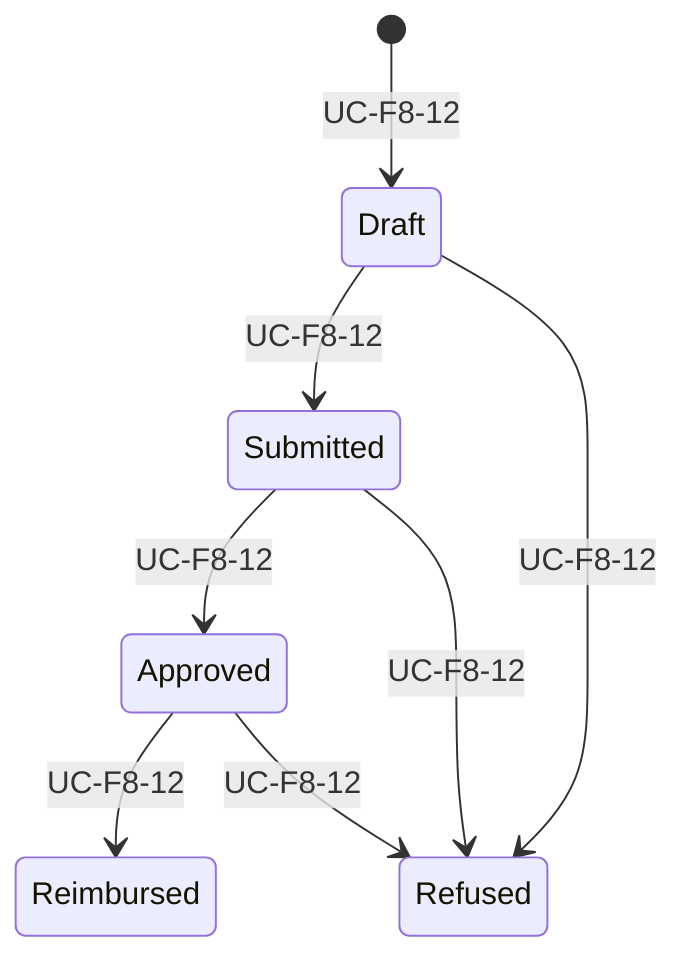

🏠 [Specs](../../../README.md) › 🧩 [Functional capabilities](../../README.md) › 📒 [F8 Accounting](../README.md) ›
🗃️ [Data](README.md) › 🗃️ E-F8-09 Expense claim

# 🗃️ E-F8-09 Expense claim

**Status:** ✅ specified

## Purpose

An employee expense.

## Fields

| Name | Type | Required | Validation | Default | Example | Personal data | Custom fields |
|---|---|---|---|---|---|---|---|
| employee | user | yes | - | - | Paul Martin | yes | no |
| category | category | yes | - | - | Meals | no | no |
| amount | money with VAT | yes | - | - | 23.40 incl. VAT | no | no |
| receipt | file | per category (BR-F8-05) | - | - | photo | maybe | no |
| state | draft, submitted, approved, refused, reimbursed | yes | - | draft | approved | no | no |

## Relations

As its use cases.

## Lifecycle

## Indexes and search

By number, date, partner.

## Retention

Accounting documents 10 years (Code de commerce L123-22). See
[CR-FR-002 Accounting records kept 10 years](../../../10-country-packs/france/accounting/cr-fr-002-accounting-records-kept-ten-years.md).

## Audit

Every change.

## Import and export

CSV, FEC where relevant.

## Used by

- [UC-F8-12](../use-cases/02-purchase-to-pay/uc-f08-12-submit-and-approve-expenses.md)

## Open questions

None.

---

⬅️ [E-F8-08 Accounting budget](e-f08-08-accounting-budget.md) · ⬆️ [Up](README.md) ·
➡️ [E-F8-10 Fiscal period](e-f08-10-fiscal-period.md)
