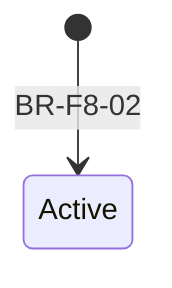

🏠 [Specs](../../../README.md) › 🧩 [Functional capabilities](../../README.md) › 📒 [F8 Accounting](../README.md) ›
🗃️ [Data](README.md) › 🗃️ E-F8-10 Fiscal period

# 🗃️ E-F8-10 Fiscal period

**Status:** ✅ specified

## Purpose

A fiscal year or period and its locks.

## Fields

| Name | Type | Required | Validation | Default | Example | Personal data | Custom fields |
|---|---|---|---|---|---|---|---|
| year | dates | yes | - | - | 2026 | no | no |
| lock dates | for others, for all, tax, hard | no | BR-F8-02 | - | October for others | no | no |

## Relations

As its use cases.

## Lifecycle

## Indexes and search

By number, date, partner.

## Retention

Accounting documents 10 years (Code de commerce L123-22). See
[CR-FR-002 Accounting records kept 10 years](../../../10-country-packs/france/accounting/cr-fr-002-accounting-records-kept-ten-years.md).

## Audit

Every change.

## Import and export

CSV, FEC where relevant.

## Used by

- [UC-F8-01](../use-cases/01-set-up-and-post/uc-f08-01-set-up-the-books.md)
- [UC-F8-10](../use-cases/05-close-report-and-consolidate/uc-f08-10-close-the-period-and-the-year.md)
- [UC-F8-25 Approve and file the annual accounts](../use-cases/08-year-end-duties/uc-f08-25-approve-and-file-the-annual-accounts.md)

## Open questions

None.

---

⬅️ [E-F8-09 Expense claim](e-f08-09-expense-claim.md) · ⬆️ [Up](README.md) ·
➡️ [E-F8-11 Consolidation group](e-f08-11-consolidation-group.md)
