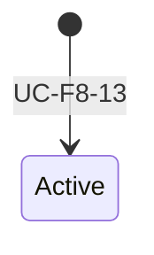

🏠 [Specs](../../../README.md) › 🧩 [Functional capabilities](../../README.md) › 📒 [F8 Accounting](../README.md) ›
🗃️ [Data](README.md) › 🗃️ E-F8-11 Consolidation group

# 🗃️ E-F8-11 Consolidation group

**Status:** ✅ specified

## Purpose

Companies consolidated together.

## Fields

| Name | Type | Required | Validation | Default | Example | Personal data | Custom fields |
|---|---|---|---|---|---|---|---|
| companies | companies | yes | - | - | Acme Bâtiment, Acme Services | no | no |
| mapping | account mapping | yes | - | - | 411000 to 411 | no | no |
| currency | currency | yes | - | EUR | EUR | no | no |

## Relations

As its use cases.

## Lifecycle

## Indexes and search

By number, date, partner.

## Retention

Accounting documents 10 years (Code de commerce L123-22). See
[CR-FR-002 Accounting records kept 10 years](../../../10-country-packs/france/accounting/cr-fr-002-accounting-records-kept-ten-years.md).

## Audit

Every change.

## Import and export

CSV, FEC where relevant.

## Used by

- [UC-F8-13](../use-cases/05-close-report-and-consolidate/uc-f08-13-consolidate-the-group.md)

## Open questions

None.

---

⬅️ [E-F8-10 Fiscal period](e-f08-10-fiscal-period.md) · ⬆️ [Up](README.md) ·
➡️ [E-F8-12 Filing partner](e-f08-12-filing-partner.md)
