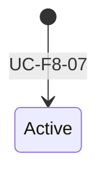

🏠 [Specs](../../../README.md) › 🧩 [Functional capabilities](../../README.md) › 📒 [F8 Accounting](../README.md) ›
🗃️ [Data](README.md) › 🗃️ E-F8-12 Filing partner

# 🗃️ E-F8-12 Filing partner

**Status:** ✅ specified

## Purpose

The EDI partner that files returns.

## Fields

| Name | Type | Required | Validation | Default | Example | Personal data | Custom fields |
|---|---|---|---|---|---|---|---|
| name | text | yes | - | - | (chosen by the company) | no | no |
| procedures | EDI-TVA, EDI-TDFC | yes | - | - | EDI-TVA | no | no |
| credential | vault handle | yes | D240 | - | edi-partner | no | no |

## Relations

As its use cases.

## Lifecycle

## Indexes and search

By number, date, partner.

## Retention

Accounting documents 10 years (Code de commerce L123-22). See
[CR-FR-002 Accounting records kept 10 years](../../../10-country-packs/france/accounting/cr-fr-002-accounting-records-kept-ten-years.md).

## Audit

Every change.

## Import and export

CSV, FEC where relevant.

## Used by

- [UC-F8-07](../use-cases/04-tax-assets-and-analytics/uc-f08-07-manage-vat-and-file-returns.md)

## Open questions

None.

---

⬅️ [E-F8-11 Consolidation group](e-f08-11-consolidation-group.md) · ⬆️ [Up](README.md) ·
➡️ [E-F8-13 Book](e-f08-13-book.md)
