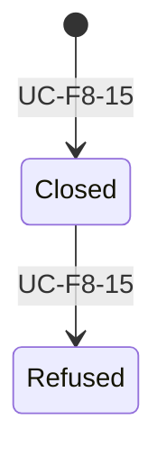

🏠 [Specs](../../../README.md) › 🧩 [Functional capabilities](../../README.md) › 📒 [F8 Accounting](../README.md) ›
🗃️ [Data](README.md) › 🗃️ E-F8-13 Book

# 🗃️ E-F8-13 Book

**Status:** ✅ specified

## Purpose

An accounting book of a company.

## Fields

| Name | Type | Required | Validation | Default | Example | Personal data | Custom fields |
|---|---|---|---|---|---|---|---|
| framework | French GAAP, IFRS, management | yes | CR-FR-064 | French GAAP | IFRS | no | no |
| adjustments | entries | no | BR-F8-10 | - | IFRS 16 | no | no |

## Relations

As its use cases.

## Lifecycle

## Indexes and search

By name, date, owner.

## Retention

Kept for the period of its kind of record in the country pack (D293), or else its kind's default in the
[retention schedule](../../../05-non-functional/data-retention.md). See
[CR-FR-002 Accounting records kept 10 years](../../../10-country-packs/france/accounting/cr-fr-002-accounting-records-kept-ten-years.md).

## Audit

Every change.

## Import and export

CSV.

## Used by

- [UC-F8-15](../use-cases/06-benchmark-additions/uc-f08-15-keep-several-books.md)

## Open questions

None.

---

⬅️ [E-F8-12 Filing partner](e-f08-12-filing-partner.md) · ⬆️ [Up](README.md) ·
➡️ [E-F8-14 Revenue schedule](e-f08-14-revenue-schedule.md)
