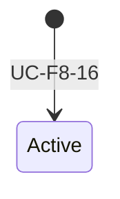

🏠 [Specs](../../../README.md) › 🧩 [Functional capabilities](../../README.md) › 📒 [F8 Accounting](../README.md) ›
🗃️ [Data](README.md) › 🗃️ E-F8-14 Revenue schedule

# 🗃️ E-F8-14 Revenue schedule

**Status:** ✅ specified

## Purpose

How a contract's revenue is recognised.

## Fields

| Name | Type | Required | Validation | Default | Example | Personal data | Custom fields |
|---|---|---|---|---|---|---|---|
| contract | record | yes | - | - | SUB-2026-014 | no | no |
| obligations | list with price and pattern | yes | BR-F8-11 | - | Licence, support | no | no |
| deferred | money | yes | - | - | 9 000.00 | no | no |

### Sector extension: SC14 IT and software

From [E-SC14-03 Revenue schedule](../../../08-sectors/sc14-it-and-software/data/e-sc14-03-revenue-schedule.md), merged
here ([D516](../../../06-decisions/foundations/d516-naming-rules-and-the-seven-classes-of-names.md), shared name
"Revenue schedule"). Recognised and deferred revenue.

| Name | Type | Required | Validation | Default | Example | Personal data | Custom fields |
|---|---|---|---|---|---|---|---|
| subscription, month | records | yes | BR-SC14-03 | - | Acme, Nov | no | no |
| recognised, deferred | amounts | yes | - | - | 1 000, 9 000 | no | no |

## Relations

As its use cases.

## Lifecycle

## Indexes and search

By name, date, owner.

## Retention

Kept for the period of its kind of record in the country pack (D293), or else its kind's default in the
[retention schedule](../../../05-non-functional/data-retention.md). See
[CR-FR-002 Accounting records kept 10 years](../../../10-country-packs/france/accounting/cr-fr-002-accounting-records-kept-ten-years.md).

## Audit

Every change.

## Import and export

CSV.

## Used by

- [UC-F8-16](../use-cases/06-benchmark-additions/uc-f08-16-recognise-revenue-under-ifrs-15.md)
- [UC-SC14-03 Recognise subscription revenue](../../../08-sectors/sc14-it-and-software/use-cases/01-subscriptions-and-billing/uc-sc14-03-recognise-subscription-revenue.md)

## Open questions

None.

---

⬅️ [E-F8-13 Book](e-f08-13-book.md) · ⬆️ [Up](README.md) · ➡️ [E-F8-15 Company card](e-f08-15-company-card.md)
