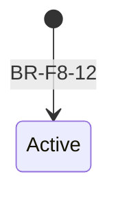

🏠 [Specs](../../../README.md) › 🧩 [Functional capabilities](../../README.md) › 📒 [F8 Accounting](../README.md) ›
🗃️ [Data](README.md) › 🗃️ E-F8-15 Company card

# 🗃️ E-F8-15 Company card

**Status:** ✅ specified

## Purpose

A virtual or physical card.

## Fields

| Name | Type | Required | Validation | Default | Example | Personal data | Custom fields |
|---|---|---|---|---|---|---|---|
| holder | user or agent | yes | - | - | Léa Moreau | yes | no |
| limit, categories | money, list | yes | BR-F8-12 | - | 1 000, travel | no | no |

## Relations

As its use cases.

## Lifecycle

## Indexes and search

By name, date, owner.

## Retention

Kept for the period of its kind of record in the country pack (D293), or else its kind's default in the
[retention schedule](../../../05-non-functional/data-retention.md). See
[CR-FR-002 Accounting records kept 10 years](../../../10-country-packs/france/accounting/cr-fr-002-accounting-records-kept-ten-years.md).

## Audit

Every change.

## Import and export

CSV.

## Used by

- [UC-F8-18](../use-cases/06-benchmark-additions/uc-f08-18-control-spend-with-cards-and-limits.md)

## Open questions

None.

---

⬅️ [E-F8-14 Revenue schedule](e-f08-14-revenue-schedule.md) · ⬆️ [Up](README.md) ·
➡️ [E-F8-16 Budget plan](e-f08-16-budget-plan.md)
