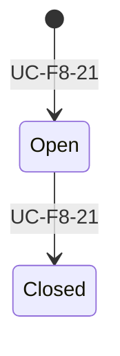

🏠 [Specs](../../../README.md) › 🧩 [Functional capabilities](../../README.md) › 📒 [F8 Accounting](../README.md) ›
🗃️ [Data](README.md) › 🗃️ E-F8-17 Client money ledger

# 🗃️ E-F8-17 Client money ledger

**Status:** ✅ specified

## Purpose

A client's balance on a segregated account, with every movement.

## Fields

| Name | Type | Required | Validation | Default | Example | Personal data | Custom fields |
|---|---|---|---|---|---|---|---|
| client | customer | yes | - | - | Landlord Blanc | yes | - |
| matter or mandate | record | no | - | - | Mandate 2024-118 | no | - |
| account | segregated bank account | yes | declared as client money | - | Client account | no | - |
| balance | amount | yes | 0 or more | 0 | 742 EUR | no | - |

## Relations

Movements are Journal entries on the segregated account; reconciled with Bank lines.

## Lifecycle

Open, closed with a zero balance.

## Indexes and search

By client and matter; the register.

## Retention

10 years, [CR-FR-002](../../../10-country-packs/france/accounting/cr-fr-002-accounting-records-kept-ten-years.md).

## Audit

Every movement.

## Import and export

None.

## Used by

- [UC-F8-21 Keep third-party client money](../use-cases/07-client-money-grants-and-non-profits/uc-f08-21-keep-third-party-client-money.md)

## Open questions

None.

---

⬅️ [E-F8-16 Budget plan](e-f08-16-budget-plan.md) · ⬆️ [Up](README.md) · ➡️ [E-F8-18 Grant](e-f08-18-grant.md)
