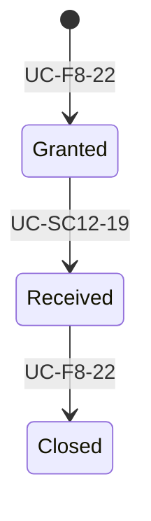

🏠 [Specs](../../../README.md) › 🧩 [Functional capabilities](../../README.md) › 📒 [F8 Accounting](../README.md) ›
🗃️ [Data](README.md) › 🗃️ E-F8-18 Grant

# 🗃️ E-F8-18 Grant

**Status:** ✅ specified

## Purpose

A grant or subsidy with its funder, conditions and recognition.

## Fields

| Name | Type | Required | Validation | Default | Example | Personal data | Custom fields |
|---|---|---|---|---|---|---|---|
| funder | customer | yes | - | - | Region | no | - |
| amount | amount | yes | - | - | 30,000 EUR | no | - |
| purpose | operations or asset | yes | - | - | van | no | - |
| conditions and period | text, dates | yes | - | - | use until 2031 | no | - |
| recognised, deferred | amounts | no | - | - | 6,000 / 24,000 | no | - |

### Sector extension: SC08 Non-profit association

From [E-SC08-08 Grant](../../../08-sectors/sc08-non-profit/data/e-sc08-08-grant.md), merged here
([D516](../../../06-decisions/foundations/d516-naming-rules-and-the-seven-classes-of-names.md), shared name "Grant").
The association's view of a grant: its application and purpose. The grant's amounts, conditions and recognition are the
shared [E-F8-18 Grant](../../../02-functional/f08-accounting/data/e-f08-18-grant.md),
[UC-F8-22](../../../02-functional/f08-accounting/use-cases/07-client-money-grants-and-non-profits/uc-f08-22-account-for-a-grant.md).

| Name | Type | Required | Validation | Default | Example | Personal data | Custom fields |
|---|---|---|---|---|---|---|---|
| funder, amount, purpose | records | yes | BR-SC08-06 | - | Town, 24 000, school | no | no |
| agreement, report due | file, date | no | - | - | 2027-06-30 | no | no |

## Relations

Tagged on expenses and Fixed assets; reported to the funder.

## Lifecycle

Granted, received, recognised, closed.

## Indexes and search

By funder and status.

## Retention

10 years from the end of the fiscal year, as a supporting document of the accounts
([CR-FR-002 Accounting records kept 10 years](../../../10-country-packs/france/accounting/cr-fr-002-accounting-records-kept-ten-years.md)).

## Audit

Recorded, recognised, reported.

## Import and export

None.

## Used by

- [UC-F8-22 Account for a grant](../use-cases/07-client-money-grants-and-non-profits/uc-f08-22-account-for-a-grant.md)
- [UC-SC08-08 Apply for grants and follow their conditions](../../../08-sectors/sc08-non-profit/use-cases/03-grants/uc-sc08-08-apply-for-grants-and-follow-their-conditions.md)
- [UC-SC08-09 Report to funders on grants](../../../08-sectors/sc08-non-profit/use-cases/03-grants/uc-sc08-09-report-to-funders-on-grants.md)
- [UC-SC08-19 Follow the association's dashboard](../../../08-sectors/sc08-non-profit/use-cases/06-accounts-and-data/uc-sc08-19-follow-the-association-s-dashboard.md)
- [UC-SC08-20 Ask the AI assistant about the association](../../../08-sectors/sc08-non-profit/use-cases/02-donations-and-receipts/uc-sc08-20-ask-the-assistant-about-the-association.md)

## Open questions

None.

---

⬅️ [E-F8-17 Client money ledger](e-f08-17-client-money-ledger.md) · ⬆️ [Up](README.md) ·
➡️ [E-F8-19 Dedicated fund](e-f08-19-dedicated-fund.md)
