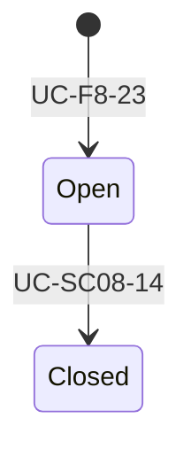

🏠 [Specs](../../../README.md) › 🧩 [Functional capabilities](../../README.md) › 📒 [F8 Accounting](../README.md) ›
🗃️ [Data](README.md) › 🗃️ E-F8-19 Dedicated fund

# 🗃️ E-F8-19 Dedicated fund

**Status:** ✅ specified

## Purpose

An association's resources kept for a purpose.

## Fields

| Name | Type | Required | Validation | Default | Example | Personal data | Custom fields |
|---|---|---|---|---|---|---|---|
| purpose | text | yes | - | - | Shelter | no | - |
| balance | amount | yes | - | - | 3,000 EUR | no | - |
| source | donations or grants | yes | - | - | donations 2026 | no | - |

### Sector extension: SC08 Non-profit association

From [E-SC08-14 Dedicated fund](../../../08-sectors/sc08-non-profit/data/e-sc08-14-dedicated-fund.md), merged here
([D516](../../../06-decisions/foundations/d516-naming-rules-and-the-seven-classes-of-names.md), shared name "Dedicated
fund"). A dedicated fund as the association follows it per purpose; the fund itself and its carry-over are the shared
[E-F8-19 Dedicated fund](../../../02-functional/f08-accounting/data/e-f08-19-dedicated-fund.md),
[UC-F8-23](../../../02-functional/f08-accounting/use-cases/07-client-money-grants-and-non-profits/uc-f08-23-keep-non-profit-accounts.md).

| Name | Type | Required | Validation | Default | Example | Personal data | Custom fields |
|---|---|---|---|---|---|---|---|
| purpose, origin | records | yes | BR-SC08-07 | - | school, grant | no | no |
| received, used, left | amounts | yes | - | - | 10 000, 4 000, 6 000 | no | no |

## Relations

Moved at year end; used by expenses of its purpose.

## Lifecycle

Open, used, closed.

## Indexes and search

By purpose.

## Retention

10 years.

## Audit

Moves.

## Import and export

None.

## Used by

- [UC-F8-23 Keep non-profit accounts](../use-cases/07-client-money-grants-and-non-profits/uc-f08-23-keep-non-profit-accounts.md)
- [UC-SC08-14 Keep association accounts](../../../08-sectors/sc08-non-profit/use-cases/06-accounts-and-data/uc-sc08-14-keep-association-accounts.md)

## Open questions

None.

---

⬅️ [E-F8-18 Grant](e-f08-18-grant.md) · ⬆️ [Up](README.md) ·
➡️ [E-F8-20 Volunteer contribution](e-f08-20-volunteer-contribution.md)
