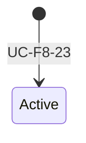

🏠 [Specs](../../../README.md) › 🧩 [Functional capabilities](../../README.md) › 📒 [F8 Accounting](../README.md) ›
🗃️ [Data](README.md) › 🗃️ E-F8-20 Volunteer contribution

# 🗃️ E-F8-20 Volunteer contribution

**Status:** ✅ specified

## Purpose

Volunteer time valued for the notes of the accounts.

## Fields

| Name | Type | Required | Validation | Default | Example | Personal data | Custom fields |
|---|---|---|---|---|---|---|---|
| period | year | yes | - | - | 2026 | no | - |
| hours | number | yes | - | - | 2,400 | no | - |
| rate | amount per hour | yes | - | - | minimum wage | no | - |

## Relations

From F9 volunteer shifts or sheets.

## Lifecycle

Per year.

## Indexes and search

By year.

## Retention

10 years.

## Audit

Valuation.

## Import and export

None.

## Used by

- [UC-F8-23 Keep non-profit accounts](../use-cases/07-client-money-grants-and-non-profits/uc-f08-23-keep-non-profit-accounts.md)

## Open questions

None.

---

⬅️ [E-F8-19 Dedicated fund](e-f08-19-dedicated-fund.md) · ⬆️ [Up](README.md) ·
➡️ [E-F8-21 Corporate tax computation](e-f08-21-corporate-tax-computation.md)
