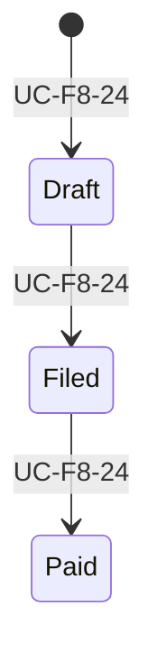

🏠 [Specs](../../../README.md) › 🧩 [Functional capabilities](../../README.md) › 📒 [F8 Accounting](../README.md) ›
🗃️ [Data](README.md) › 🗃️ E-F8-21 Corporate tax computation

# 🗃️ E-F8-21 Corporate tax computation

**Status:** ✅ specified

## Purpose

A year's corporate tax, adjustments, instalments and local business taxes.

## Fields

| Name | Type | Required | Validation | Default | Example | Personal data | Custom fields |
|---|---|---|---|---|---|---|---|
| year | year | yes | - | - | 2026 | no | - |
| result and adjustments | amounts | yes | - | - | 182,000 + 6,000 | no | - |
| tax | amount | yes | - | - | 41,250 EUR | no | - |
| instalments | dates and amounts | yes | - | - | 4 x 9,000 | no | - |
| CFE, CVAE | amounts and dates | no | - | - | CFE 1,840 EUR | no | - |

## Relations

Linked to the Tax return (E-F8-06).

## Lifecycle

Draft, filed, paid.

## Indexes and search

By year.

## Retention

10 years.

## Audit

Computed, filed, paid.

## Import and export

None.

## Used by

- [UC-F8-24 Compute and pay corporate tax and local business taxes](../use-cases/08-year-end-duties/uc-f08-24-compute-and-pay-corporate-tax-and-local-business-taxes.md)

## Open questions

None.

---

⬅️ [E-F8-20 Volunteer contribution](e-f08-20-volunteer-contribution.md) · ⬆️ [Up](README.md) ·
➡️ [E-F8-22 Annual accounts file](e-f08-22-annual-accounts-file.md)
