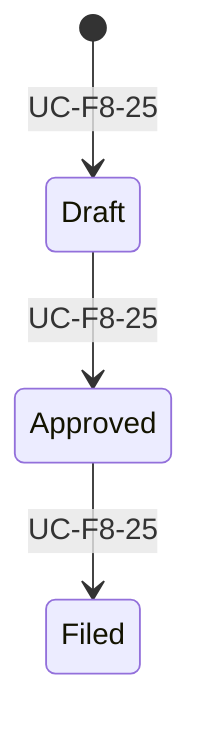

🏠 [Specs](../../../README.md) › 🧩 [Functional capabilities](../../README.md) › 📒 [F8 Accounting](../README.md) ›
🗃️ [Data](README.md) › 🗃️ E-F8-22 Annual accounts file

# 🗃️ E-F8-22 Annual accounts file

**Status:** ✅ specified

## Purpose

A year's annual accounts with their approval and filing.

## Fields

| Name | Type | Required | Validation | Default | Example | Personal data | Custom fields |
|---|---|---|---|---|---|---|---|
| year | year | yes | - | - | 2026 | no | - |
| documents | files | yes | - | - | balance sheet, income statement, notes | no | - |
| approval | date, minutes | no | within six months | - | 2027-05-20 | no | - |
| filing | date, status | no | - | - | filed 2027-06-02 | no | - |

## Relations

One per Fiscal period (E-F8-10).

## Lifecycle

Draft, approved, filed.

## Indexes and search

By year.

## Retention

10 years.

## Audit

Drafted, approved, filed.

## Import and export

None.

## Used by

- [UC-F8-25 Approve and file the annual accounts](../use-cases/08-year-end-duties/uc-f08-25-approve-and-file-the-annual-accounts.md)

## Open questions

None.

---

⬅️ [E-F8-21 Corporate tax computation](e-f08-21-corporate-tax-computation.md) · ⬆️ [Up](README.md) ·
➡️ [E-F8-23 Doubtful debt provision](e-f08-23-doubtful-debt-provision.md)
