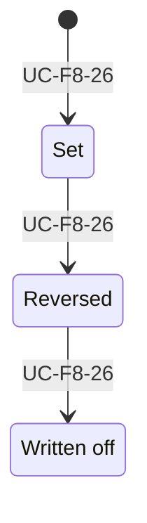

🏠 [Specs](../../../README.md) › 🧩 [Functional capabilities](../../README.md) › 📒 [F8 Accounting](../README.md) ›
🗃️ [Data](README.md) › 🗃️ E-F8-23 Doubtful debt provision

# 🗃️ E-F8-23 Doubtful debt provision

**Status:** ✅ specified

## Purpose

A provision on an invoice at risk.

## Fields

| Name | Type | Required | Validation | Default | Example | Personal data | Custom fields |
|---|---|---|---|---|---|---|---|
| invoice | invoice | yes | unpaid | - | INV-2026-0911 | no | - |
| rate and amount | percent, amount | yes | - | - | 50 %, 1,000 EUR | no | - |
| reason | age, dispute, procedure | yes | - | - | 200 days | no | - |
| status | set, reversed, written off | yes | - | set | set | no | - |

## Relations

On one Invoice; posted as Journal entries.

## Lifecycle

Set, reversed or written off.

## Indexes and search

By customer and status.

## Retention

10 years.

## Audit

Every change.

## Import and export

None.

## Used by

- [UC-F8-26 Provision doubtful debts](../use-cases/08-year-end-duties/uc-f08-26-provision-doubtful-debts.md)

## Open questions

None.

---

⬅️ [E-F8-22 Annual accounts file](e-f08-22-annual-accounts-file.md) · ⬆️ [Up](README.md) ·
➡️ [E-F8-24 Variance comment](e-f08-24-variance-comment.md)
