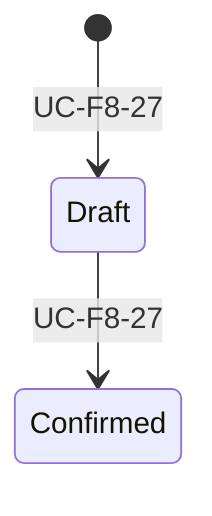

🏠 [Specs](../../../README.md) › 🧩 [Functional capabilities](../../README.md) › 📒 [F8 Accounting](../README.md) ›
🗃️ [Data](README.md) › 🗃️ E-F8-24 Variance comment

# 🗃️ E-F8-24 Variance comment

**Status:** ✅ specified

## Purpose

A comment explaining an account's variance for a month.

## Fields

| Name | Type | Required | Validation | Default | Example | Personal data | Custom fields |
|---|---|---|---|---|---|---|---|
| account and month | account, month | yes | - | - | Rent, 2026-11 | no | - |
| variance | amount, percent | yes | - | - | +3,800 EUR, +38 % | no | - |
| comment | text | yes | - | - | New depot from October | no | - |
| status | draft, confirmed | yes | - | draft | confirmed | no | - |

## Relations

Per Account and Fiscal period.

## Lifecycle

Draft, confirmed.

## Indexes and search

By month.

## Retention

10 years.

## Audit

Drafted, edited, confirmed.

## Import and export

None.

## Used by

- [UC-F8-27 Analyse the month's flux with AI comments](../use-cases/09-pay-analyse-and-report/uc-f08-27-analyse-the-months-flux-with-ai-comments.md)

## Open questions

None.

---

⬅️ [E-F8-23 Doubtful debt provision](e-f08-23-doubtful-debt-provision.md) · ⬆️ [Up](README.md) ·
➡️ [E-F8-25 Sustainability report](e-f08-25-sustainability-report.md)
