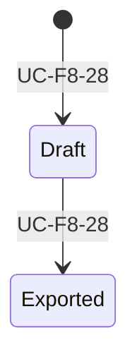

🏠 [Specs](../../../README.md) › 🧩 [Functional capabilities](../../README.md) › 📒 [F8 Accounting](../README.md) ›
🗃️ [Data](README.md) › 🗃️ E-F8-25 Sustainability report

# 🗃️ E-F8-25 Sustainability report

**Status:** ✅ specified

## Purpose

A year's sustainability figures with their sources.

## Fields

| Name | Type | Required | Validation | Default | Example | Personal data | Custom fields |
|---|---|---|---|---|---|---|---|
| year | year | yes | - | - | 2026 | no | - |
| figures | list of name, value, unit, source | yes | - | - | energy 410 MWh, bills | no | - |
| status | draft, exported | yes | - | draft | exported | no | - |

## Relations

Reads Emission factors (E-F7-20), bills and HR records.

## Lifecycle

Draft, exported.

## Indexes and search

By year.

## Retention

10 years, like the accounting records and the management report (Code de commerce L123-22), for the voluntary VSME
report too ([D575](../../../06-decisions/foundations/d575-answers-of-2026-11-27-on-the-last-open-points.md)).

## Audit

Figures entered, exported.

## Import and export

None.

## Used by

- [UC-F8-28 Prepare the sustainability report](../use-cases/09-pay-analyse-and-report/uc-f08-28-prepare-the-sustainability-report.md)

## Open questions

None.

---

⬅️ [E-F8-24 Variance comment](e-f08-24-variance-comment.md) · ⬆️ [Up](README.md) ·
➡️ [E-F8-26 Accountant request](e-f08-26-accountant-request.md)
