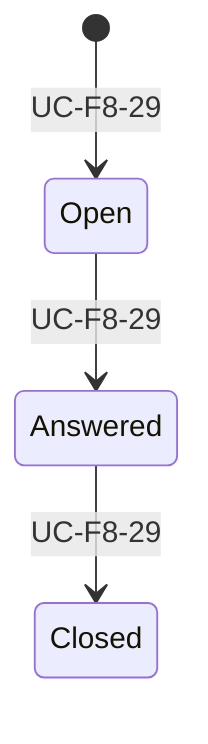

🏠 [Specs](../../../README.md) › 🧩 [Functional capabilities](../../README.md) › 📒 [F8 Accounting](../README.md) ›
🗃️ [Data](README.md) › 🗃️ E-F8-26 Accountant request

# 🗃️ E-F8-26 Accountant request

**Status:** ✅ specified

## Purpose

A question or a missing-receipt request on entries.

## Fields

| Name | Type | Required | Validation | Default | Example | Personal data | Custom fields |
|---|---|---|---|---|---|---|---|
| entries | list | yes | - | - | 12 card payments | no | - |
| kind | question, receipt | yes | - | - | receipt | no | - |
| assignee | user | yes | - | - | Lea Roux | yes | - |
| status | open, answered, closed | yes | - | open | answered | no | - |

## Relations

On Journal entries; answers and files linked.

## Lifecycle

Open, answered, closed.

## Indexes and search

By status and period.

## Retention

10 years with the entries.

## Audit

Asked, answered, closed.

## Import and export

None.

## Used by

- [UC-F8-29 Answer the accountant's questions and requests](../use-cases/10-accountant-collaboration/uc-f08-29-answer-the-accountants-questions-and-requests.md)

## Open questions

None.

---

⬅️ [E-F8-25 Sustainability report](e-f08-25-sustainability-report.md) · ⬆️ [Up](README.md) ·
➡️ [E-F8-27 FEC file](e-f08-27-fec-file.md)
