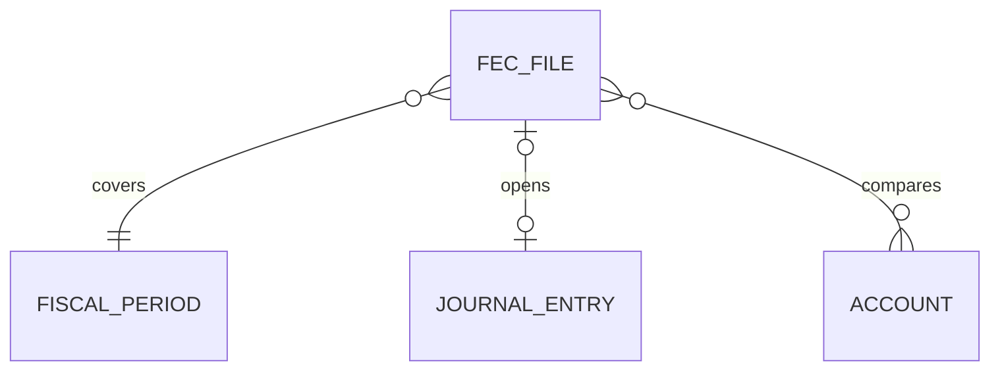
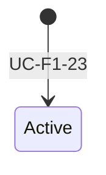

🏠 [Specs](../../../README.md) › 🧩 [Functional capabilities](../../README.md) › 📒 [F8 Accounting](../README.md) ›
🗃️ [Data](README.md) › 🗃️ E-F8-27 FEC file

# 🗃️ E-F8-27 FEC file

**Status:** ✅ specified

## Purpose

The FEC file the flow charts name with the words "FEC"
([FL-F1-14](../../f01-administration/flows/fl-f01-14-close-a-company.md),
[FL-F21-05](../../f21-onboarding-and-modules/flows/fl-f21-05-migration-from-another-tool.md),
[FL-F8-01](../flows/fl-f08-01-set-up-and-post.md), [FL-F8-05](../flows/fl-f08-05-close-report-and-consolidate.md)). The
owner decided to create it
([D516](../../../06-decisions/foundations/d516-naming-rules-and-the-seven-classes-of-names.md)); its fields are derived
from the specifications and confirmed by the owner (D572).

## Fields

| Name | Type | Required | Validation | Default | Example | Personal data | Custom fields |
|---|---|---|---|---|---|---|---|
| fiscal year | fiscal period (E-F8-10) | yes | a fiscal year of the company | - | 2025 | no | no |
| origin | produced, imported | yes | one of the two | - | imported | no | no |
| file | file in the official format | yes | the format of the country pack (CR-FR-005) | - | FEC 2025 | no | no |
| lines | number | no | 0 or more | computed | 2,140 | no | no |
| check | passed, refused | yes | the built-in FEC checker (CR-FR-005) | - | passed | no | no |
| refused line | text | when refused | the first line in error | - | line 1,204: journal code missing | no | no |
| differences | list of account and amount | no | closing balances of the file against the opening balances (BR-F21-13) | none | 411 Durand SA, 120.00 EUR | no | no |
| state | Active | yes | the lifecycle below | Active | Active | no | no |

The title shown in the list is "FEC" and the fiscal year: "FEC 2025"
([S-F8-L27](../screens/00-lists/s-f08-l27-fec-files.md)). The company produces the FEC of a year at any time, checked
before it is handed over, and imports a previous system's FEC
([CR-FR-005](../../../10-country-packs/france/accounting/cr-fr-005-fec-export.md)): it is produced at year end
([UC-F8-10](../use-cases/05-close-report-and-consolidate/uc-f08-10-close-the-period-and-the-year.md), step 4 and
acceptance criterion 3) and with all the data of a closed company
([UC-F1-23](../../f01-administration/use-cases/14-close-a-company/uc-f01-23-close-a-company-and-export-all-its-data.md));
it is imported for the opening balances
([UC-F8-01](../use-cases/01-set-up-and-post/uc-f08-01-set-up-the-books.md), step 3 and acceptance criterion 2) and
compared with them per account, an invalid file being refused with its line
([UC-F21-22](../../f21-onboarding-and-modules/use-cases/05-migration-from-another-tool/uc-f21-22-check-opening-balances-against-last-years-fec.md),
[BR-F21-13](../../f21-onboarding-and-modules/business-rules/br-f21-13-opening-balances-match-last-years-fec.md)).

## Relations

- [E-F8-10 Fiscal period](e-f08-10-fiscal-period.md)
- [E-F8-03 Journal entry](e-f08-03-journal-entry.md): the opening entry an imported file creates.
- [E-F8-01 Account](e-f08-01-account.md): the differences are listed per account.

## Lifecycle

## Indexes and search

Searched by fiscal year; filtered by origin, check and state
([S-F8-L27](../screens/00-lists/s-f08-l27-fec-files.md)).

## Retention

As the other records of its capability.

## Audit

Every change, as the other records of its capability.

## Import and export

Exported in the official format of the country pack, checked by the FEC checker before it is handed over; a previous
system's FEC is imported in the same format and refused with its line when invalid
([CR-FR-005](../../../10-country-packs/france/accounting/cr-fr-005-fec-export.md),
[UC-F21-22](../../f21-onboarding-and-modules/use-cases/05-migration-from-another-tool/uc-f21-22-check-opening-balances-against-last-years-fec.md)).

## Used by

- [UC-F1-23 Close a company and export all its data](../../f01-administration/use-cases/14-close-a-company/uc-f01-23-close-a-company-and-export-all-its-data.md)
- [UC-F21-22 Check opening balances against last year's FEC](../../f21-onboarding-and-modules/use-cases/05-migration-from-another-tool/uc-f21-22-check-opening-balances-against-last-years-fec.md)
- [UC-F8-01 Set up the books](../use-cases/01-set-up-and-post/uc-f08-01-set-up-the-books.md)
- [UC-F8-10 Close the period and the year](../use-cases/05-close-report-and-consolidate/uc-f08-10-close-the-period-and-the-year.md)

## Open questions

None.

---

⬅️ [E-F8-26 Accountant request](e-f08-26-accountant-request.md) · ⬆️ [Up](README.md) ·
➡️ [E-F8-28 Payment run](e-f08-28-payment-run.md)
