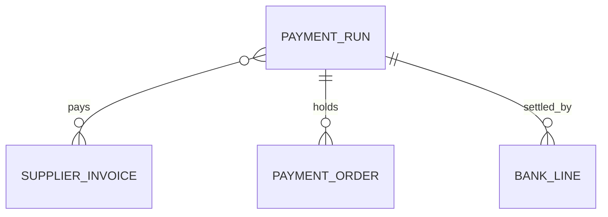
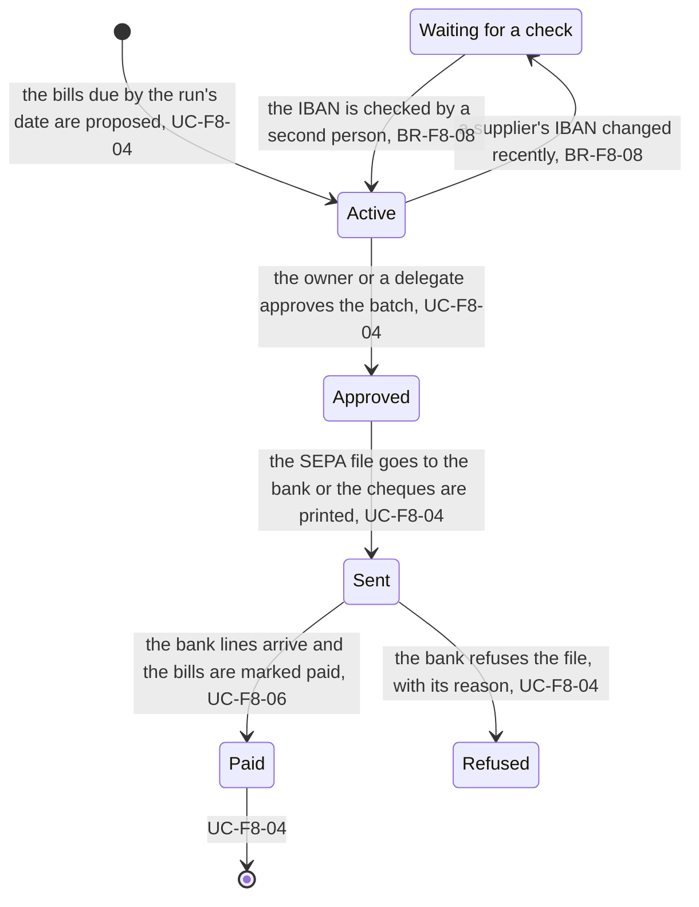

🏠 [Specs](../../../README.md) › 🧩 [Functional capabilities](../../README.md) › 📒 [F8 Accounting](../README.md) ›
🗃️ [Data](README.md) › 🗃️ E-F8-28 Payment run

# 🗃️ E-F8-28 Payment run

**Status:** ✅ specified

## Purpose

The payment run the flow charts name with the words "Payment batch", "Payment run", "SEPA file"
([FL-F8-02](../flows/fl-f08-02-purchase-to-pay.md), [FL-F8-09](../flows/fl-f08-09-pay-analyse-and-report.md)). The owner
decided to create it ([D516](../../../06-decisions/foundations/d516-naming-rules-and-the-seven-classes-of-names.md));
its fields are derived from the specifications and confirmed by the owner (D572).

## Fields

| Name | Type | Required | Validation | Default | Example | Personal data | Custom fields |
|---|---|---|---|---|---|---|---|
| run date | date | yes | - | - | 2026-11-15 | no | no |
| bills | list of supplier invoice (E-F7-05) | yes | approved, open and due by the run date | the bills due by the run date | FA-2026-881 | no | no |
| tax instalments | list of tax payments due | no | due by the run date (UC-F8-24) | the instalments due | corporate tax instalment | no | no |
| payment orders | list of payment order (E-F8-38) | no | one per supplier | - | Rexel 6,940.00 EUR | no | no |
| total | amount with currency | yes | sum of the bills less the discounts | computed | 7,252.00 EUR | no | no |
| early-payment discounts | amount with currency | no | the discounts the bills allow, taken first | computed | 2 % on Rexel | no | no |
| payment means | SEPA credit transfer, cheque, bank API | yes | the SEPA format of the country pack (CR-FR-023) | - | SEPA credit transfer | no | no |
| approved by | user | no | the owner or their delegate | - | Claire P. | yes | no |
| bank's reason | text | when refused | set by the bank | - | invalid file | no | no |
| state | Active, Waiting for a check, Approved, Sent, Paid, Refused | yes | the lifecycle below | Active | Approved | no | no |

The title shown in the list is the run date and the count of bills: "Run 2026-11-15, 14 bills"
([S-F8-L28](../screens/00-lists/s-f08-l28-payment-runs.md)). The fields come from
[UC-F8-04](../use-cases/02-purchase-to-pay/uc-f08-04-pay-suppliers.md) (bills due by the run's date, early-payment
discounts first, tax instalments, the owner's approval of the batch, the SEPA file or cheques, the bank's refusal) and
its mock-up of [S-F8-04](../screens/02-purchase-to-pay/s-f08-04-supplier-payments.md) (supplier, bills, amount,
discount, total), the one payment order per supplier of
[UC-F8-34](../use-cases/11-treasury-and-payment-means/uc-f08-34-pay-suppliers-from-the-erp.md), and the check of a
changed IBAN of [BR-F8-08](../business-rules/br-f08-08-new-ibans-are-checked.md). A cooperative pays its members'
advances through the same run
([UC-SC13-23](../../../08-sectors/sc13-agriculture-and-food/use-cases/06-vineyards-contractors-and-cooperatives/uc-sc13-23-run-a-cooperative.md)).

### Merged in: E-F8-32 Supplier payment

From [E-F8-32 Supplier payment](e-f08-32-supplier-payment.md), merged here (the owner's answer S2-9 of 2026-11-13).
The supplier payment the flow charts name with the words "SEPA transfer or cheque"
([FL-F8-02](../flows/fl-f08-02-purchase-to-pay.md)). The owner decided to create it
([D516](../../../06-decisions/foundations/d516-naming-rules-and-the-seven-classes-of-names.md)); its fields are those of
the payment run above: the transfer or cheque of each supplier is a payment order of the run.

## Relations

- [E-F7-05 Supplier invoice](../../f07-purchasing-and-stock/data/e-f07-05-supplier-invoice.md)
- [E-F8-38 Payment order](e-f08-38-payment-order.md)
- [E-F8-04 Bank line](e-f08-04-bank-line.md): the bills are marked paid when the bank lines arrive
  ([UC-F8-06](../use-cases/03-bank-and-collect/uc-f08-06-connect-banks-and-reconcile.md)).
- [E-F8-21 Corporate tax computation](e-f08-21-corporate-tax-computation.md): the tax instalments due.
- [E-SC20-04 Treasury exchange](../../../08-sectors/sc20-public-bodies/data/e-sc20-04-treasury-exchange.md): what a
  public body sends to its public accountant instead.

## Lifecycle

## Indexes and search

Searched by the title and the supplier of its bills; filtered by state, run date and payment means
([S-F8-L28](../screens/00-lists/s-f08-l28-payment-runs.md), [S-F8-04](../screens/02-purchase-to-pay/s-f08-04-supplier-payments.md)).

## Retention

As the other records of its capability.

## Audit

Every change, as the other records of its capability.

## Import and export

No import. The run is exported as the SEPA credit transfer file sent to the bank
([CR-FR-023](../../../10-country-packs/france/payments/cr-fr-023-sepa-formats.md)); CSV or XLSX export of the fields the
user may see (T3).

## Used by

- [UC-F8-04 Pay suppliers](../use-cases/02-purchase-to-pay/uc-f08-04-pay-suppliers.md)
- [UC-F8-03 Process supplier bills](../use-cases/02-purchase-to-pay/uc-f08-03-process-supplier-bills.md)

## Open questions

None.

---

⬅️ [E-F8-27 FEC file](e-f08-27-fec-file.md) · ⬆️ [Up](README.md) ·
➡️ [E-F8-29 Entry annotation](e-f08-29-entry-annotation.md)
