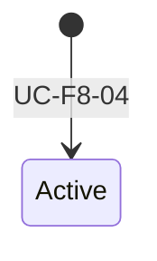

🏠 [Specs](../../../README.md) › 🧩 [Functional capabilities](../../README.md) › 📒 [F8 Accounting](../README.md) ›
🗃️ [Data](README.md) › 🗃️ E-F8-28 Payment run

# 🗃️ E-F8-28 Payment run

**Status:** 🔄 waiting for the owner

## Purpose

(Proposed) The payment run the flow charts name with the words "Payment batch", "Payment run", "SEPA file"
([FL-F8-02](../flows/fl-f08-02-purchase-to-pay.md), [FL-F8-09](../flows/fl-f08-09-pay-analyse-and-report.md)). The owner
decided to create it ([D516](../../../06-decisions/foundations/d516-naming-rules-and-the-seven-classes-of-names.md));
what it holds waits for the owner's confirmation.

## Fields

(Proposed) To define with the owner: the flow charts name the record, not its fields.

### Merged in: E-F8-32 Supplier payment

From [E-F8-32 Supplier payment](e-f08-32-supplier-payment.md), merged here (the owner's answer S2-9 of 2026-11-13).
(Proposed) The supplier payment the flow charts name with the words "SEPA transfer or cheque"
([FL-F8-02](../flows/fl-f08-02-purchase-to-pay.md)). The owner decided to create it
([D516](../../../06-decisions/foundations/d516-naming-rules-and-the-seven-classes-of-names.md)); what it holds waits for
the owner's confirmation.

## Relations

(Proposed) To define with the owner, from the use cases below.

## Lifecycle

## Indexes and search

(Proposed) To define with the owner.

## Retention

(Proposed) As the other records of its capability, to confirm with the owner.

## Audit

(Proposed) Every change, as the other records of its capability.

## Import and export

(Proposed) To define with the owner.

## Used by

- [UC-F8-04 Pay suppliers](../use-cases/02-purchase-to-pay/uc-f08-04-pay-suppliers.md)
- [UC-F8-03 Process supplier bills](../use-cases/02-purchase-to-pay/uc-f08-03-process-supplier-bills.md)

## Open questions

(Proposed) Its fields, relations and states wait for the owner (waiting list, step 36e).

---

⬅️ [E-F8-27 FEC file](e-f08-27-fec-file.md) · ⬆️ [Up](README.md) ·
➡️ [E-F8-29 Entry annotation](e-f08-29-entry-annotation.md)
