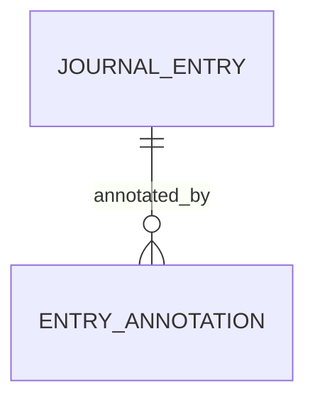
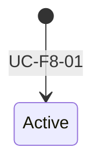

🏠 [Specs](../../../README.md) › 🧩 [Functional capabilities](../../README.md) › 📒 [F8 Accounting](../README.md) ›
🗃️ [Data](README.md) › 🗃️ E-F8-29 Entry annotation

# 🗃️ E-F8-29 Entry annotation

**Status:** ✅ specified

## Purpose

The entry annotation the flow charts name with the words "Annotations", "annotations"
([FL-F8-01](../flows/fl-f08-01-set-up-and-post.md), [FL-F8-05](../flows/fl-f08-05-close-report-and-consolidate.md)). The
owner decided to create it
([D516](../../../06-decisions/foundations/d516-naming-rules-and-the-seven-classes-of-names.md)); its fields are derived
from the specifications and confirmed by the owner (D572).

## Fields

| Name | Type | Required | Validation | Default | Example | Personal data | Custom fields |
|---|---|---|---|---|---|---|---|
| entry | journal entry (E-F8-03) | yes | an entry of the company, draft or posted | - | VTE/2026/00412 | no | no |
| text | text | yes | stripped, not empty | - | check VAT | no | no |
| author | user | yes | an accountant, the external accountant or the owner | the creator | Claire P. | yes | no |
| state | Active | yes | the lifecycle below | Active | Active | no | no |

The title shown in the list is the entry and the text: "VTE/2026/00412, check VAT"
([S-F8-L29](../screens/00-lists/s-f08-l29-entry-annotations.md)). Accountants review and annotate the entries
([UC-F8-02](../use-cases/01-set-up-and-post/uc-f08-02-post-and-review-entries.md),
[FL-F8-01](../flows/fl-f08-01-set-up-and-post.md)), the external accountant from their workspace
([UC-F8-14](../use-cases/01-set-up-and-post/uc-f08-14-work-with-the-external-accountant.md) and its mock-up, "3
annotations" on the entries to review), and the owner from the reports drilled down to their entries
([UC-F8-11](../use-cases/05-close-report-and-consolidate/uc-f08-11-read-financial-reports.md),
[FL-F8-05](../flows/fl-f08-05-close-report-and-consolidate.md)). An annotation never changes a posted entry
([BR-F8-01](../business-rules/br-f08-01-posted-entries-never-change.md)); a question that needs an answer is an
[accountant request](e-f08-26-accountant-request.md).

## Relations

- [E-F8-03 Journal entry](e-f08-03-journal-entry.md)
- [E-F8-26 Accountant request](e-f08-26-accountant-request.md): the questions and requests raised on the same entries.

## Lifecycle

## Indexes and search

Searched by the entry and the text; filtered by author and state
([S-F8-L29](../screens/00-lists/s-f08-l29-entry-annotations.md)).

## Retention

As the other records of its capability.

## Audit

Every change, as the other records of its capability.

## Import and export

No import. Exported with the reports and entries they annotate, as PDF or spreadsheet
([UC-F8-11](../use-cases/05-close-report-and-consolidate/uc-f08-11-read-financial-reports.md)); CSV or XLSX export of
the fields the user may see (T3).

## Used by

- [UC-F8-01 Set up the books](../use-cases/01-set-up-and-post/uc-f08-01-set-up-the-books.md)
- [UC-F8-10 Close the period and the year](../use-cases/05-close-report-and-consolidate/uc-f08-10-close-the-period-and-the-year.md)

## Open questions

None.

---

⬅️ [E-F8-28 Payment run](e-f08-28-payment-run.md) · ⬆️ [Up](README.md) ·
➡️ [E-F8-30 Analytic plan](e-f08-30-analytic-plan.md)
