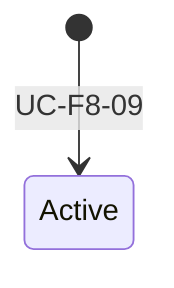

🏠 [Specs](../../../README.md) › 🧩 [Functional capabilities](../../README.md) › 📒 [F8 Accounting](../README.md) ›
🗃️ [Data](README.md) › 🗃️ E-F8-30 Analytic plan

# 🗃️ E-F8-30 Analytic plan

**Status:** 🔄 waiting for the owner

## Purpose

(Proposed) The analytic plan the flow charts name with the words "Analytic plans"
([FL-F8-04](../flows/fl-f08-04-tax-assets-and-analytics.md)). The owner decided to create it
([D516](../../../06-decisions/foundations/d516-naming-rules-and-the-seven-classes-of-names.md)); what it holds waits for
the owner's confirmation.

## Fields

(Proposed) To define with the owner: the flow charts name the record, not its fields.

## Relations

(Proposed) To define with the owner, from the use cases below.

## Lifecycle

## Indexes and search

(Proposed) To define with the owner.

## Retention

(Proposed) As the other records of its capability, to confirm with the owner.

## Audit

(Proposed) Every change, as the other records of its capability.

## Import and export

(Proposed) To define with the owner.

## Used by

- [UC-F8-09 Track analytics and budgets](../use-cases/04-tax-assets-and-analytics/uc-f08-09-track-analytics-and-budgets.md)

## Open questions

(Proposed) Its fields, relations and states wait for the owner (waiting list, step 36e).

---

⬅️ [E-F8-29 Entry annotation](e-f08-29-entry-annotation.md) · ⬆️ [Up](README.md) ·
➡️ [E-F8-31 Closing checklist](e-f08-31-closing-checklist.md)
