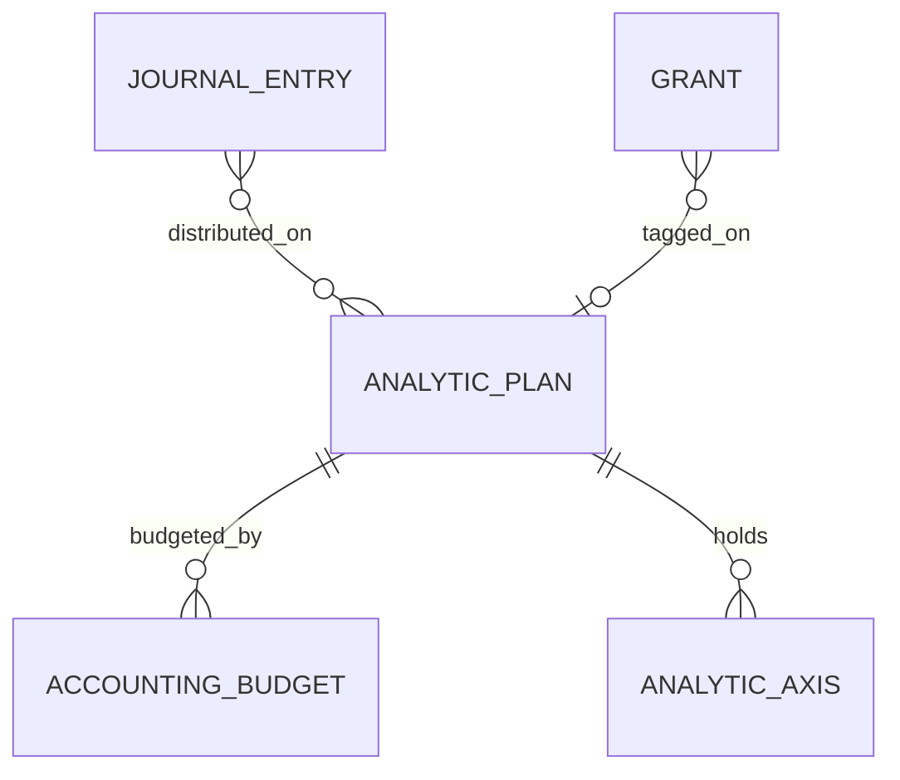
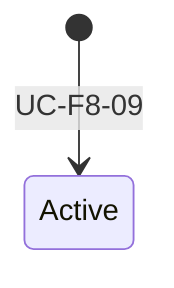

🏠 [Specs](../../../README.md) › 🧩 [Functional capabilities](../../README.md) › 📒 [F8 Accounting](../README.md) ›
🗃️ [Data](README.md) › 🗃️ E-F8-30 Analytic plan

# 🗃️ E-F8-30 Analytic plan

**Status:** ✅ specified

## Purpose

The analytic plan the flow charts name with the words "Analytic plans"
([FL-F8-04](../flows/fl-f08-04-tax-assets-and-analytics.md)). The owner decided to create it
([D516](../../../06-decisions/foundations/d516-naming-rules-and-the-seven-classes-of-names.md)); its fields are derived
from the specifications and confirmed by the owner (D572).

## Fields

| Name | Type | Required | Validation | Default | Example | Personal data | Custom fields |
|---|---|---|---|---|---|---|---|
| name | text | yes | - | - | Projects | no | no |
| analytic accounts | list of text | no | - | none | Villeurbanne 40 flats, Lyon office | no | no |
| mandatory | yes or no | yes | a line without this plan is refused when yes | no | yes | no | no |
| distribution models | list of analytic account and share | no | the shares of a model cover the whole line | none | 60 % Villeurbanne, 40 % Lyon office | no | no |
| state | Active | yes | the lifecycle below | Active | Active | no | no |

The name and the state are the columns of the list view [S-F8-L30](../screens/00-lists/s-f08-l30-analytic-plans.md),
whose mock-up names plans such as Projects, Sites, Departments and Funding; a plan is kept per project, site or
department, distributes each line by hand or by models, and a mandatory plan left out is refused
([UC-F8-09](../use-cases/04-tax-assets-and-analytics/uc-f08-09-track-analytics-and-budgets.md), main flow 1 and error
flow 1e). Its analytic accounts are the rows of budget versus actual on
[S-F8-09](../screens/04-tax-assets-and-analytics/s-f08-09-analytics-and-budgets.md) (Villeurbanne, 40 flats; Lyon
office), budgeted per plan and account ([FL-F8-04](../flows/fl-f08-04-tax-assets-and-analytics.md)).

## Relations

- [E-F8-08 Accounting budget](e-f08-08-accounting-budget.md): a budget per plan and account.
- [E-F13-25 Analytic axis](../../f13-payroll/data/e-f13-25-analytic-axis.md): the axes payroll costs are split on.
- [E-F8-03 Journal entry](e-f08-03-journal-entry.md): its lines are distributed on the plans.
- [E-F8-18 Grant](e-f08-18-grant.md): what a grant finances is tagged
  ([UC-F8-22](../use-cases/07-client-money-grants-and-non-profits/uc-f08-22-account-for-a-grant.md)).

## Lifecycle

## Indexes and search

Searched by name; filtered by mandatory and state
([S-F8-L30](../screens/00-lists/s-f08-l30-analytic-plans.md)).

## Retention

As the other records of its capability.

## Audit

Every change, as the other records of its capability.

## Import and export

No import. CSV or XLSX export of the fields the user may see (T3).

## Used by

- [UC-F8-09 Track analytics and budgets](../use-cases/04-tax-assets-and-analytics/uc-f08-09-track-analytics-and-budgets.md)

## Open questions

None.

---

⬅️ [E-F8-29 Entry annotation](e-f08-29-entry-annotation.md) · ⬆️ [Up](README.md) ·
➡️ [E-F8-31 Closing checklist](e-f08-31-closing-checklist.md)
