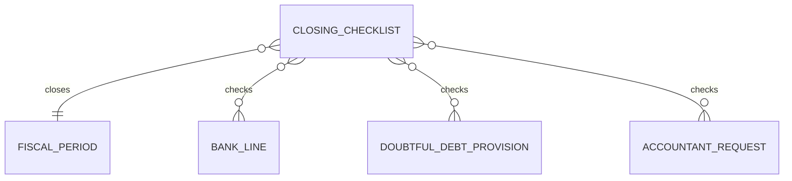
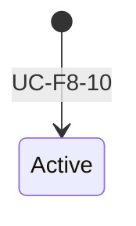

🏠 [Specs](../../../README.md) › 🧩 [Functional capabilities](../../README.md) › 📒 [F8 Accounting](../README.md) ›
🗃️ [Data](README.md) › 🗃️ E-F8-31 Closing checklist

# 🗃️ E-F8-31 Closing checklist

**Status:** ✅ specified

## Purpose

The closing checklist the flow charts name with the words "Closing checklist"
([FL-F8-05](../flows/fl-f08-05-close-report-and-consolidate.md)). The owner decided to create it
([D516](../../../06-decisions/foundations/d516-naming-rules-and-the-seven-classes-of-names.md)); its fields are derived
from the specifications and confirmed by the owner (D572).

## Fields

| Name | Type | Required | Validation | Default | Example | Personal data | Custom fields |
|---|---|---|---|---|---|---|---|
| period | fiscal period (E-F8-10) | yes | a period of the company | - | October 2026 | no | no |
| kind | month-end, quarter-end, year-end | yes | one of the three | - | year-end | no | no |
| tasks | list of task, each done or not | yes | the tasks of the kind | the tasks of the kind | bank reconciled, accruals and cut-off, depreciation posted, stock valued, VAT filed | no | no |
| blocking items | list of open items | no | listed while a task cannot be done | none | 3 bank lines not reconciled | no | no |
| run by | user | no | an accountant or the external accountant | - | Claire P. | yes | no |
| state | Active | yes | the lifecycle below | Active | Active | no | no |

The title shown in the list is the kind and the period: "Month-end October 2026", "Year-end 2025"
([S-F8-L31](../screens/00-lists/s-f08-l31-closing-checklists.md)). The tasks come from
[UC-F8-10](../use-cases/05-close-report-and-consolidate/uc-f08-10-close-the-period-and-the-year.md) (banks reconciled,
accruals, depreciation, stock, VAT, doubtful debts, open questions, then lock dates, year-end entries and the hard lock)
and its mock-up of [S-F8-10](../screens/05-close-report-and-consolidate/s-f08-10-closing.md); an unreconciled bank line
blocks the checklist and is listed (error flow 1e), and the external accountant may run the closing (alternative flow
1a). The checklist comes before the lock dates of [BR-F8-02](../business-rules/br-f08-02-lock-dates.md)
([FL-F8-05](../flows/fl-f08-05-close-report-and-consolidate.md)); the statutory auditor reads it
([UC-F8-36](../use-cases/12-audit-leases-and-special-books/uc-f08-36-open-the-books-to-the-statutory-auditor.md)).

## Relations

- [E-F8-10 Fiscal period](e-f08-10-fiscal-period.md)
- [E-F8-04 Bank line](e-f08-04-bank-line.md): every line reconciled.
- [E-F8-23 Doubtful debt provision](e-f08-23-doubtful-debt-provision.md)
  ([UC-F8-26](../use-cases/08-year-end-duties/uc-f08-26-provision-doubtful-debts.md)).
- [E-F8-26 Accountant request](e-f08-26-accountant-request.md): the open questions
  ([UC-F8-29](../use-cases/10-accountant-collaboration/uc-f08-29-answer-the-accountants-questions-and-requests.md)).
- [E-F8-27 FEC file](e-f08-27-fec-file.md): produced once the year is closed.

## Lifecycle

## Indexes and search

Searched by the title; filtered by kind, period and state
([S-F8-L31](../screens/00-lists/s-f08-l31-closing-checklists.md)).

## Retention

As the other records of its capability.

## Audit

Every change, as the other records of its capability.

## Import and export

No import. CSV or XLSX export of the fields the user may see (T3).

## Used by

- [UC-F8-10 Close the period and the year](../use-cases/05-close-report-and-consolidate/uc-f08-10-close-the-period-and-the-year.md)

## Open questions

None.

---

⬅️ [E-F8-30 Analytic plan](e-f08-30-analytic-plan.md) · ⬆️ [Up](README.md) ·
➡️ [E-F8-32 Supplier payment](e-f08-32-supplier-payment.md)
