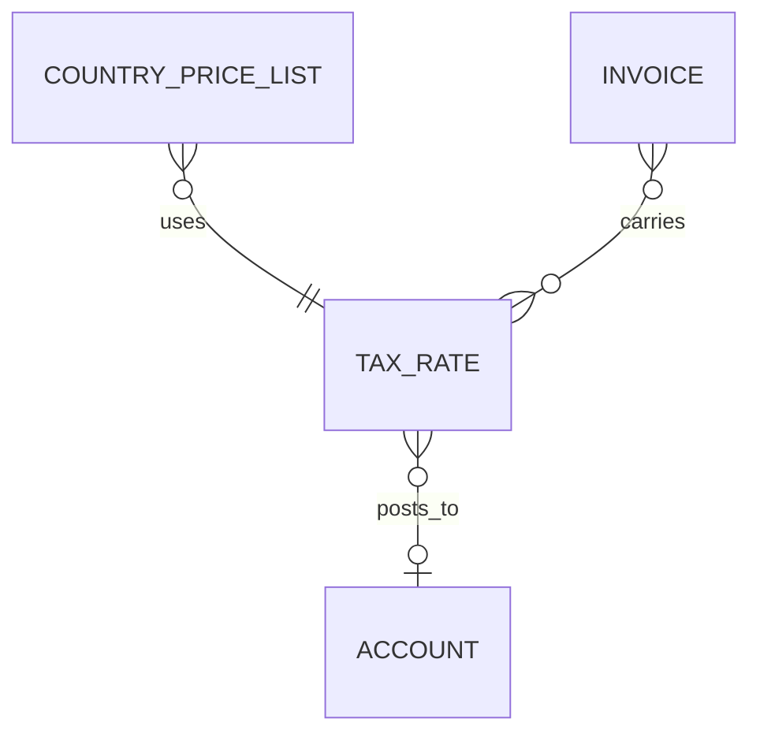
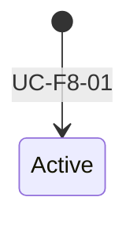

🏠 [Specs](../../../README.md) › 🧩 [Functional capabilities](../../README.md) › 📒 [F8 Accounting](../README.md) ›
🗃️ [Data](README.md) › 🗃️ E-F8-33 Tax rate

# 🗃️ E-F8-33 Tax rate

**Status:** ✅ specified

## Purpose

The tax rate the flow charts name with the words "taxes" ([FL-F8-01](../flows/fl-f08-01-set-up-and-post.md)).
The owner decided to create it
([D516](../../../06-decisions/foundations/d516-naming-rules-and-the-seven-classes-of-names.md)); its fields are derived
from the specifications and confirmed by the owner (D572).

## Fields

| Name | Type | Required | Validation | Default | Example | Personal data | Custom fields |
|---|---|---|---|---|---|---|---|
| name | text | yes | - | - | VAT 20 % | no | no |
| country | country | yes | a country of a country pack | - | France | no | no |
| rate | percent | yes | the rate the country pack sets (France: CR-FR-008) | - | 20 | no | no |
| treatment | VAT charged, reverse charge, intra-EU, exempt | yes | one of the four | - | reverse charge | no | no |
| legal mention | text | when no VAT is charged | the mention of the country pack (BR-F6-08, CR-FR-009) | - | Autoliquidation | no | no |
| account | account (E-F8-01) | no | a tax account of the chart | - | 445710 VAT collected 20 % | no | no |
| valid from | date | no | a rate change applies from its date, never to an issued document (CR-FR-008) | - | the date the country pack gives | no | no |
| origin | country pack, company | no | one of the two | - | country pack | no | no |
| state | Active | yes | the lifecycle below | Active | Active | no | no |

The name and the state are the columns of the list view [S-F8-L33](../screens/00-lists/s-f08-l33-tax-rates.md), whose
mock-up names rates such as VAT 20 %, VAT 5.5 %, Reverse charge 20 %, Autoliquidation construction and Intra-EU 0 %.
The country pack sets the taxes when the books are set up and the accountant adjusts the fiscal positions
([UC-F8-01](../use-cases/01-set-up-and-post/uc-f08-01-set-up-the-books.md), main flow 1 and 2, acceptance criterion
1); every line carries its rate and a sale without VAT carries its legal mention
([BR-F6-08](../../f06-customers-and-sales/business-rules/br-f06-08-vat-is-shown-wherever-it-matters.md)); the account
is the one the review mock-up of [S-F8-02](../screens/01-set-up-and-post/s-f08-02-journal-entries.md) shows; the rate
of each country of delivery serves the one-stop-shop sales
([UC-F11-33](../../f11-online-shop/use-cases/11-donations-gift-cards-and-cross-border/uc-f11-33-sell-across-borders.md),
[BR-F11-28](../../f11-online-shop/business-rules/br-f11-28-vat-follows-the-customers-country-under-oss.md)).

## Relations

- [E-F8-01 Account](e-f08-01-account.md)
- [E-F11-27 Country price list](../../f11-online-shop/data/e-f11-27-country-price-list.md)
- [E-F6-05 Invoice](../../f06-customers-and-sales/data/e-f06-05-invoice.md): its totals give the VAT per rate.
- [E-F8-06 Tax return](e-f08-06-tax-return.md): the VAT per rate and per country is declared.

## Lifecycle

## Indexes and search

Searched by name and rate; filtered by country, treatment, origin and state
([S-F8-L33](../screens/00-lists/s-f08-l33-tax-rates.md)).

## Retention

As the other records of its capability.

## Audit

Every change, as the other records of its capability.

## Import and export

No import: the rates come with the country pack. CSV or XLSX export of the fields the user may see (T3).

## Used by

- [UC-F8-01 Set up the books](../use-cases/01-set-up-and-post/uc-f08-01-set-up-the-books.md)

## Open questions

None.

---

⬅️ [E-F8-32 Supplier payment](e-f08-32-supplier-payment.md) · ⬆️ [Up](README.md) · ➡️ [E-F8-34 Loan](e-f08-34-loan.md)
