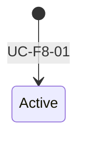

🏠 [Specs](../../../README.md) › 🧩 [Functional capabilities](../../README.md) › 📒 [F8 Accounting](../README.md) ›
🗃️ [Data](README.md) › 🗃️ E-F8-33 Tax rate

# 🗃️ E-F8-33 Tax rate

**Status:** 🔄 waiting for the owner

## Purpose

(Proposed) The tax rate the flow charts name with the words "taxes" ([FL-F8-01](../flows/fl-f08-01-set-up-and-post.md)).
The owner decided to create it
([D516](../../../06-decisions/foundations/d516-naming-rules-and-the-seven-classes-of-names.md)); what it holds waits for
the owner's confirmation.

## Fields

(Proposed) To define with the owner: the flow charts name the record, not its fields.

## Relations

(Proposed) To define with the owner, from the use cases below.

## Lifecycle

## Indexes and search

(Proposed) To define with the owner.

## Retention

(Proposed) As the other records of its capability, to confirm with the owner.

## Audit

(Proposed) Every change, as the other records of its capability.

## Import and export

(Proposed) To define with the owner.

## Used by

- [UC-F8-01 Set up the books](../use-cases/01-set-up-and-post/uc-f08-01-set-up-the-books.md)

## Open questions

(Proposed) Its fields, relations and states wait for the owner (waiting list, step 36e).

---

⬅️ [E-F8-32 Supplier payment](e-f08-32-supplier-payment.md) · ⬆️ [Up](README.md) · ➡️ [E-F8-34 Loan](e-f08-34-loan.md)
