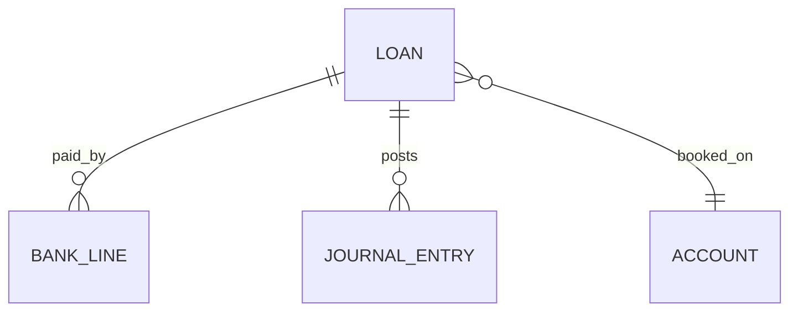
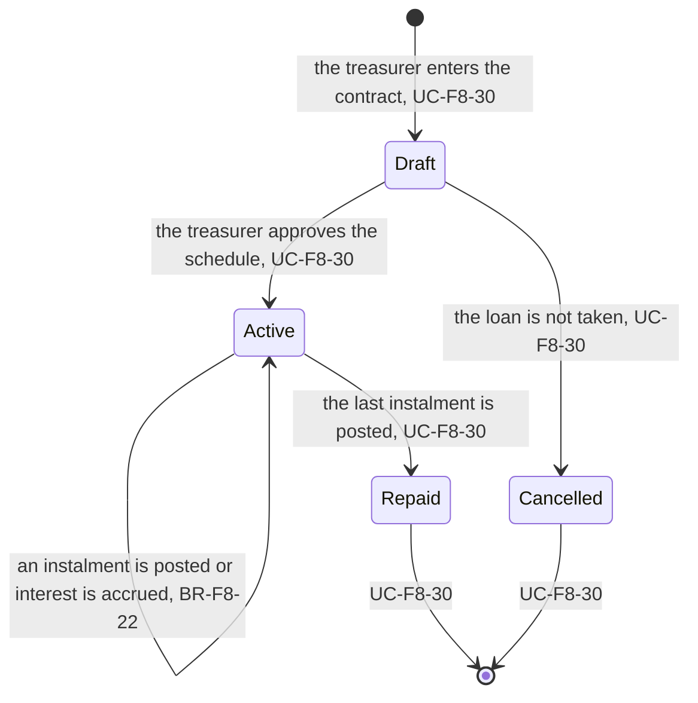

🏠 [Specs](../../../README.md) › 🧩 [Functional capabilities](../../README.md) › 📒 [F8 Accounting](../README.md) ›
🗃️ [Data](README.md) › 🗃️ E-F8-34 Loan

# 🗃️ E-F8-34 Loan

**Status:** ✅ specified

## Purpose

A loan or borrowing of the company: its terms, its repayment schedule and its balance
([D527](../../../06-decisions/f08-accounting/d527-benchmark-gaps-f08-accounting.md)).

## Fields

| Name | Type | Required | Validation | Default | Example | Personal data | Custom fields |
|---|---|---|---|---|---|---|---|
| name | text | yes | unique per company | - | Banque du Nord 2026 | no | no |
| lender | text | yes | - | - | Banque du Nord | no | no |
| amount | amount with currency | yes | more than 0 | - | 200,000 EUR | no | no |
| rate | percent and fixed or variable | yes | 0 or more | - | 3.20 fixed | no | no |
| term | months | yes | 1 to 600 | - | 120 | no | no |
| repayment type | constant instalment, constant principal or at maturity | yes | one of the three | constant instalment | constant instalment | no | no |
| start date, first due date | two dates | yes | first due after start | - | 2026-11-05, 2026-12-05 | no | no |
| schedule | list of due date, principal, interest | yes | principal adds up to the amount | computed | 120 lines | no | no |
| contract | file | no | PDF | - | contract.pdf | no | no |
| state | Draft, Active, Cancelled, Repaid | yes | the lifecycle below | Draft | Active | no | no |
| owner | user | yes | a user of the company | the creator | Claire P. | yes | no |

## Relations

- [E-F8-04 Bank line](e-f08-04-bank-line.md)
- [E-F8-03 Journal entry](e-f08-03-journal-entry.md)
- [E-F8-01 Account](e-f08-01-account.md)

## Lifecycle

## Indexes and search

By lender, state, due date and balance.

## Retention

Kept 10 years after it is repaid, with its entries
([CR-FR-002](../../../10-country-packs/france/accounting/cr-fr-002-accounting-records-kept-ten-years.md)).

## Audit

Every change of terms, schedule and state, and every entry posted, with who, when and the old and the new value.

## Import and export

Import a schedule from the lender's CSV; export the schedule and the balances as a CSV.

## Used by

- [UC-F8-30](../use-cases/11-treasury-and-payment-means/uc-f08-30-manage-loans-and-borrowings.md)

## Open questions

None.

---

⬅️ [E-F8-33 Tax rate](e-f08-33-tax-rate.md) · ⬆️ [Up](README.md) ·
➡️ [E-F8-35 Remittance slip](e-f08-35-remittance-slip.md)
