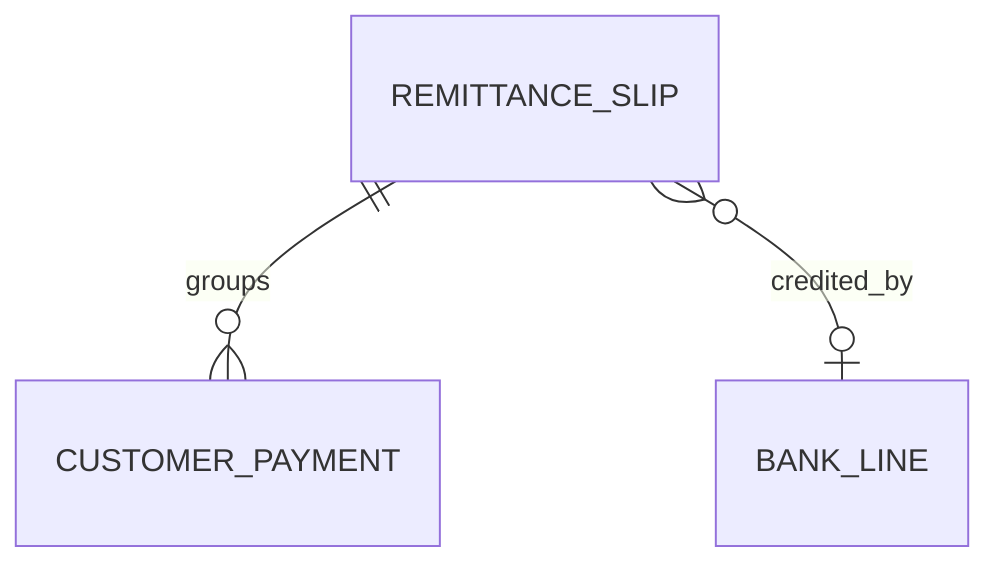
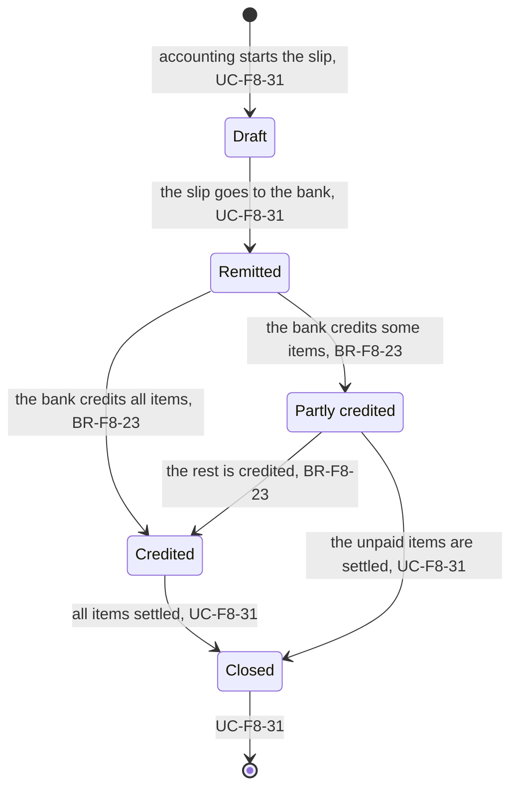

🏠 [Specs](../../../README.md) › 🧩 [Functional capabilities](../../README.md) › 📒 [F8 Accounting](../README.md) ›
🗃️ [Data](README.md) › 🗃️ E-F8-35 Remittance slip

# 🗃️ E-F8-35 Remittance slip

**Status:** ✅ specified

## Purpose

A remittance slip: a group of cheques or LCR given to one bank account, with their states until the bank credits them
([D527](../../../06-decisions/f08-accounting/d527-benchmark-gaps-f08-accounting.md)).

## Fields

| Name | Type | Required | Validation | Default | Example | Personal data | Custom fields |
|---|---|---|---|---|---|---|---|
| number | text | yes | unique | generated | RS-2026-044 | no | no |
| type | cheque deposit or LCR | yes | one of the two | cheque deposit | cheque deposit | no | no |
| bank account | bank account | yes | an account of the company | - | BNP-1 | no | no |
| items | list of number, drawer, bank, amount, due date | yes | at least one | - | 12 cheques | no | no |
| total | amount with currency | yes | sum of the items | computed | 8,640 EUR | no | no |
| remitted on | date | no | not in the future | - | 2026-11-12 | no | no |
| credited amount | amount with currency | no | 0 up to the total | 0 | 8,490 EUR | no | no |
| bank line | bank line (E-F8-04) | no | the credit that matches | - | BL-9921 | no | no |
| state | Draft, Remitted, Credited, Partly credited, Closed | yes | the lifecycle below | Draft | Remitted | no | no |
| owner | user | yes | a user of the company | the creator | Claire P. | yes | no |

## Relations

- [E-F6-06 Customer payment](../../f06-customers-and-sales/data/e-f06-06-customer-payment.md)
- [E-F8-04 Bank line](e-f08-04-bank-line.md)

## Lifecycle

## Indexes and search

By number, type, bank account, state and date remitted.

## Retention

Kept 10 years with the entries
([CR-FR-002](../../../10-country-packs/france/accounting/cr-fr-002-accounting-records-kept-ten-years.md)).

## Audit

Every item added, remittance, credit matched and unpaid item, with who, when and the bank reference.

## Import and export

Export the slip as the bank's deposit slip or LCR file; import the bank's rejection list.

## Used by

- [UC-F8-31](../use-cases/11-treasury-and-payment-means/uc-f08-31-issue-lcr-and-deposit-cheques.md)

## Open questions

None.

---

⬅️ [E-F8-34 Loan](e-f08-34-loan.md) · ⬆️ [Up](README.md) · ➡️ [E-F8-36 Revaluation run](e-f08-36-revaluation-run.md)
