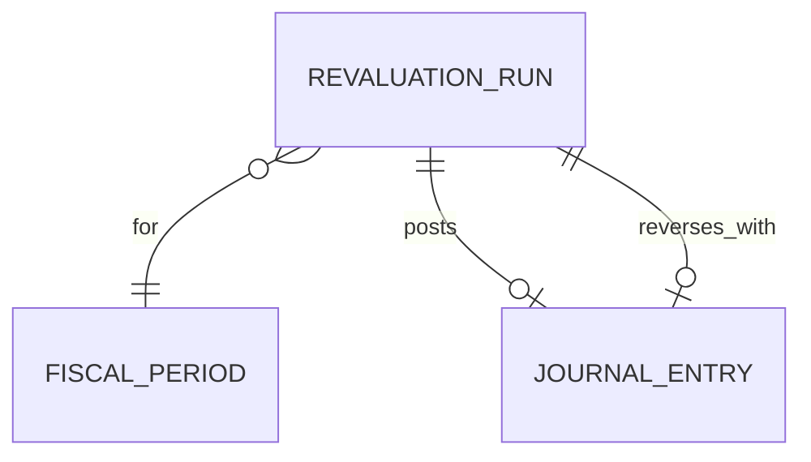
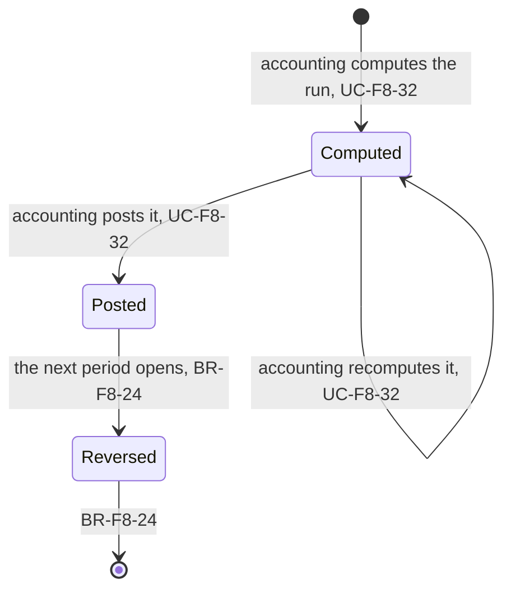

🏠 [Specs](../../../README.md) › 🧩 [Functional capabilities](../../README.md) › 📒 [F8 Accounting](../README.md) ›
🗃️ [Data](README.md) › 🗃️ E-F8-36 Revaluation run

# 🗃️ E-F8-36 Revaluation run

**Status:** ✅ specified

## Purpose

One revaluation run of a period: the items revalued, the rates and the unrealised difference
([D527](../../../06-decisions/f08-accounting/d527-benchmark-gaps-f08-accounting.md)).

## Fields

| Name | Type | Required | Validation | Default | Example | Personal data | Custom fields |
|---|---|---|---|---|---|---|---|
| period | fiscal period (E-F8-10) | yes | an open period | - | October 2026 | no | no |
| currencies | list of currency and closing rate | yes | a rate per currency | - | USD 0.9412 | no | no |
| lines | list of item, booked value, closing value | yes | - | computed | 17 items | no | no |
| unrealised difference | amount with sign | yes | sum of the lines | computed | -1,240 EUR | no | no |
| entry | journal entry (E-F8-03) | no | set when posted | - | JE-2026-1031 | no | no |
| reversal entry | journal entry (E-F8-03) | no | set when reversed | - | JE-2026-1101 | no | no |
| overrides | list of item, rate, reason | no | a reason for each | none | none | no | no |
| state | Computed, Posted, Reversed | yes | the lifecycle below | Computed | Posted | no | no |
| owner | user | yes | a user of the company | the creator | Claire P. | yes | no |

## Relations

- [E-F8-10 Fiscal period](e-f08-10-fiscal-period.md)
- [E-F8-03 Journal entry](e-f08-03-journal-entry.md)

## Lifecycle

## Indexes and search

By period, state and unrealised difference.

## Retention

Kept 10 years with the entries
([CR-FR-002](../../../10-country-packs/france/accounting/cr-fr-002-accounting-records-kept-ten-years.md)).

## Audit

Every computation, override, posting and reversal, with who, when and the amounts.

## Import and export

Export the run as a CSV or a PDF for the accountant; no import.

## Used by

- [UC-F8-32](../use-cases/11-treasury-and-payment-means/uc-f08-32-revalue-foreign-currency-items.md)

## Open questions

None.

---

⬅️ [E-F8-35 Remittance slip](e-f08-35-remittance-slip.md) · ⬆️ [Up](README.md) ·
➡️ [E-F8-37 Cash forecast](e-f08-37-cash-forecast.md)
