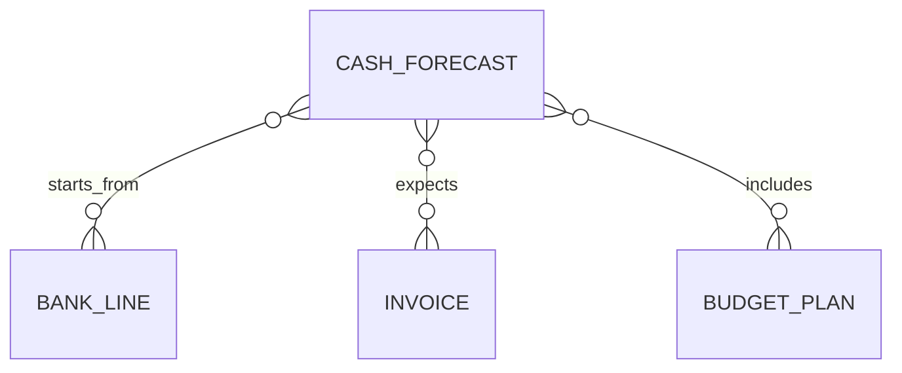
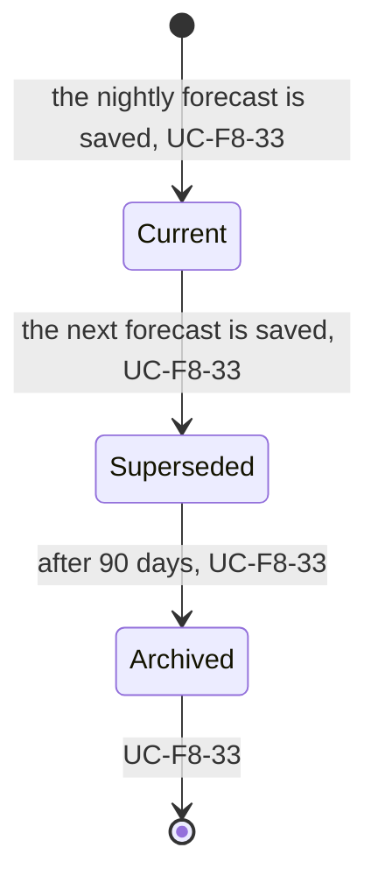

🏠 [Specs](../../../README.md) › 🧩 [Functional capabilities](../../README.md) › 📒 [F8 Accounting](../README.md) ›
🗃️ [Data](README.md) › 🗃️ E-F8-37 Cash forecast

# 🗃️ E-F8-37 Cash forecast

**Status:** ✅ specified

## Purpose

One day's cash forecast: the opening balance, the expected receipts and payments by day and the lowest point
([D527](../../../06-decisions/f08-accounting/d527-benchmark-gaps-f08-accounting.md)).

## Fields

| Name | Type | Required | Validation | Default | Example | Personal data | Custom fields |
|---|---|---|---|---|---|---|---|
| as of | date | yes | today or earlier | today | 2026-11-14 | no | no |
| horizon | weeks | yes | 1 to 52 | 13 | 13 | no | no |
| opening balance | amount with currency | yes | sum of the bank accounts | computed | 84,300 EUR | no | no |
| daily balances | list of date and amount | yes | one per day of the horizon | computed | 91 days | no | no |
| lowest point | amount and date | yes | - | computed | 12,100 EUR, 2027-01-05 | no | no |
| floor | amount with currency | no | 0 or more | from the settings | 20,000 EUR | no | no |
| sources | list of source and age | yes | - | computed | 3 banks, 212 invoices, 2 plans | no | no |
| state | Current, Superseded, Archived | yes | the lifecycle below | Current | Superseded | no | no |
| owner | user | yes | a user of the company | the creator | Claire P. | yes | no |

## Relations

- [E-F8-04 Bank line](e-f08-04-bank-line.md)
- [E-F6-05 Invoice](../../f06-customers-and-sales/data/e-f06-05-invoice.md)
- [E-F8-16 Budget plan](e-f08-16-budget-plan.md)

## Lifecycle

## Indexes and search

By as-of date, lowest point and state.

## Retention

Kept 13 months, then only the lowest point per day is kept for the comparison with actuals.

## Audit

Every forecast with its sources and ages, and every manual change of an expected date.

## Import and export

Export a forecast as a CSV or a PDF; no import.

## Used by

- [UC-F8-33](../use-cases/11-treasury-and-payment-means/uc-f08-33-follow-the-daily-cash-position.md)

## Open questions

None.

---

⬅️ [E-F8-36 Revaluation run](e-f08-36-revaluation-run.md) · ⬆️ [Up](README.md) ·
➡️ [E-F8-38 Payment order](e-f08-38-payment-order.md)
