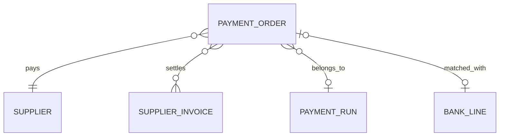
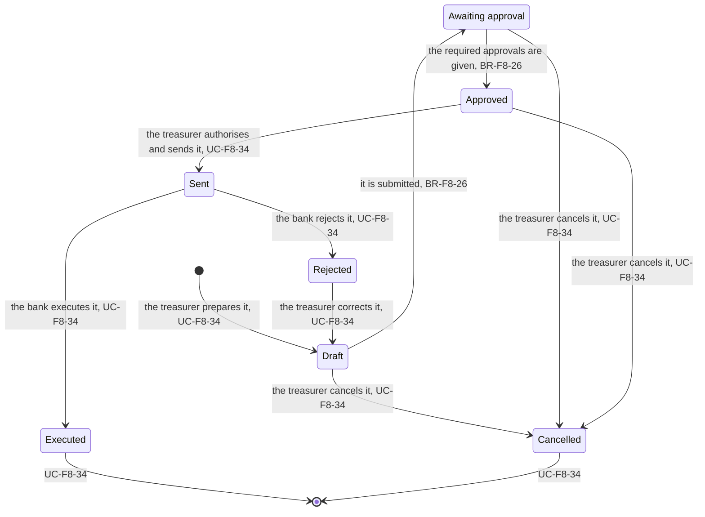

🏠 [Specs](../../../README.md) › 🧩 [Functional capabilities](../../README.md) › 📒 [F8 Accounting](../README.md) ›
🗃️ [Data](README.md) › 🗃️ E-F8-38 Payment order

# 🗃️ E-F8-38 Payment order

**Status:** ✅ specified

## Purpose

One payment to a supplier prepared in simple-ERP: the bill, the amount, the IBAN, the approvals and the bank's answer
([D527](../../../06-decisions/f08-accounting/d527-benchmark-gaps-f08-accounting.md)).

## Fields

| Name | Type | Required | Validation | Default | Example | Personal data | Custom fields |
|---|---|---|---|---|---|---|---|
| supplier | supplier (E-F7-01) | yes | an active supplier | - | Menuiserie Dupont | no | no |
| bills | list of supplier invoice (E-F7-05) | yes | approved and open | - | FA-2026-881 | no | no |
| amount | amount with currency | yes | more than 0 | sum of the bills | 18,000 EUR | no | no |
| IBAN | text | yes | a checked IBAN of the supplier | the supplier's | FR76 ... 1234 | no | no |
| bank account | bank account | yes | an account of the company | - | BNP-1 | no | no |
| execution date | date | yes | a working day, not in the past | next working day | 2026-11-16 | no | no |
| approvals | list of user and time | no | two different people above the limit | none | Claire P., Marc T. | no | no |
| bank reference | text | no | set by the bank | - | PI-5530918 | no | no |
| state | Draft, Awaiting approval, Approved, Sent, Executed, Rejected, Cancelled | yes | the lifecycle below | Draft | Awaiting approval | no | no |
| owner | user | yes | a user of the company | the creator | Claire P. | yes | no |

## Relations

- [E-F7-01 Supplier record](../../f07-purchasing-and-stock/data/e-f07-01-supplier-record.md)
- [E-F7-05 Supplier invoice](../../f07-purchasing-and-stock/data/e-f07-05-supplier-invoice.md)
- [E-F8-28 Payment run](e-f08-28-payment-run.md)
- [E-F8-04 Bank line](e-f08-04-bank-line.md)

## Lifecycle

## Indexes and search

By supplier, state, execution date and amount.

## Retention

Kept 10 years with the bank lines
([CR-FR-002](../../../10-country-packs/france/accounting/cr-fr-002-accounting-records-kept-ten-years.md)); the IBAN is
masked in lists.

## Audit

Every order, approval, authorisation, sending and bank answer, with who, when and how.

## Import and export

Export the orders of a run as a SEPA file or a CSV; no import.

## Used by

- [UC-F8-34](../use-cases/11-treasury-and-payment-means/uc-f08-34-pay-suppliers-from-the-erp.md)

## Open questions

None.

---

⬅️ [E-F8-37 Cash forecast](e-f08-37-cash-forecast.md) · ⬆️ [Up](README.md) ·
➡️ [E-F8-39 Entry template](e-f08-39-entry-template.md)
