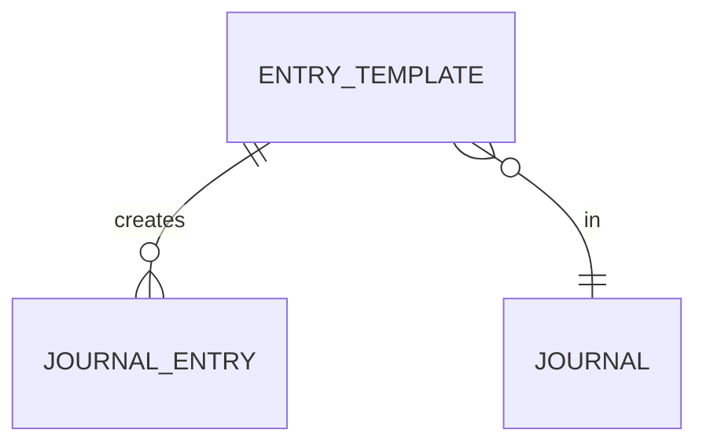
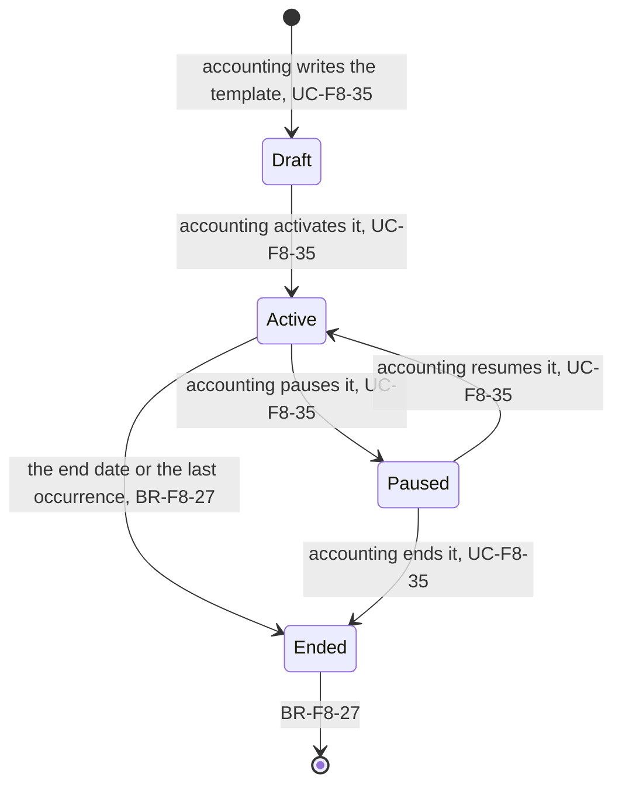

🏠 [Specs](../../../README.md) › 🧩 [Functional capabilities](../../README.md) › 📒 [F8 Accounting](../README.md) ›
🗃️ [Data](README.md) › 🗃️ E-F8-39 Entry template

# 🗃️ E-F8-39 Entry template

**Status:** ✅ specified

## Purpose

A template of an entry that repeats: its lines, its schedule, its mode and its end
([D527](../../../06-decisions/f08-accounting/d527-benchmark-gaps-f08-accounting.md)).

## Fields

| Name | Type | Required | Validation | Default | Example | Personal data | Custom fields |
|---|---|---|---|---|---|---|---|
| name | text | yes | unique per company | - | Office rent | no | no |
| journal | journal (E-F8-02) | yes | an open journal | - | Miscellaneous | no | no |
| lines | list of account, debit, credit | yes | debits equal credits | - | 2 lines | no | no |
| frequency | monthly, quarterly or yearly | yes | one of the three | monthly | monthly | no | no |
| start date | date | yes | - | - | 2026-12-01 | no | no |
| end date | date | no | after the start date, or a number of occurrences | - | 2027-09-30 | no | no |
| mode | draft or post | yes | one of the two | draft | draft | no | no |
| next due date | date | no | computed | computed | 2026-12-01 | no | no |
| entries created | number | no | 0 or more | 0 | 1 | no | no |
| state | Draft, Active, Paused, Ended | yes | the lifecycle below | Draft | Active | no | no |
| owner | user | yes | a user of the company | the creator | Claire P. | yes | no |

## Relations

- [E-F8-03 Journal entry](e-f08-03-journal-entry.md)
- [E-F8-02 Journal](e-f08-02-journal.md)

## Lifecycle

## Indexes and search

By name, state, next due date and journal.

## Retention

Kept 10 years with the entries
([CR-FR-002](../../../10-country-packs/france/accounting/cr-fr-002-accounting-records-kept-ten-years.md)).

## Audit

Every change of lines, schedule and mode, and every entry created, with who or what and when.

## Import and export

Import templates from a CSV; export them with their schedule.

## Used by

- [UC-F8-35](../use-cases/11-treasury-and-payment-means/uc-f08-35-schedule-recurring-entries.md)

## Open questions

None.

---

⬅️ [E-F8-38 Payment order](e-f08-38-payment-order.md) · ⬆️ [Up](README.md) ·
➡️ [E-F8-40 Audit request](e-f08-40-audit-request.md)
