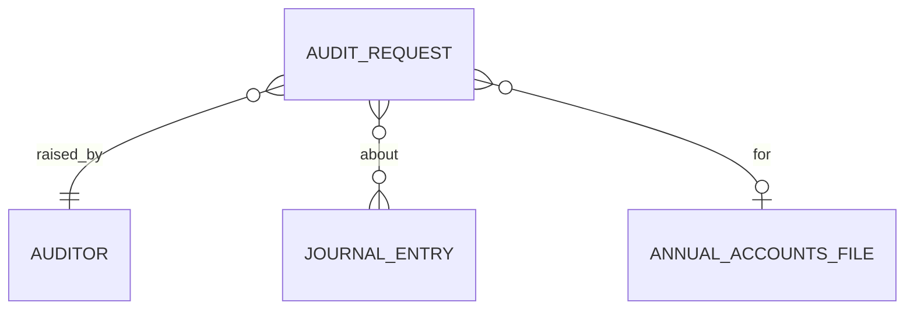
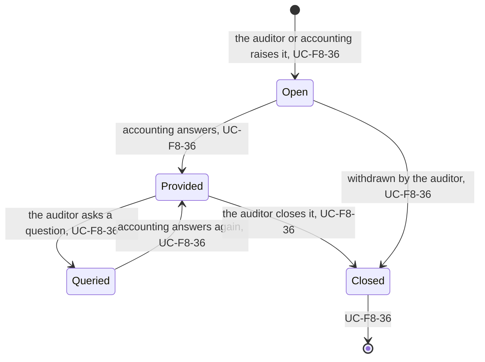

🏠 [Specs](../../../README.md) › 🧩 [Functional capabilities](../../README.md) › 📒 [F8 Accounting](../README.md) ›
🗃️ [Data](README.md) › 🗃️ E-F8-40 Audit request

# 🗃️ E-F8-40 Audit request

**Status:** ✅ specified

## Purpose

One request of the statutory auditor to the company: what is asked, the answer and the views of the books around it
([D527](../../../06-decisions/f08-accounting/d527-benchmark-gaps-f08-accounting.md)).

## Fields

| Name | Type | Required | Validation | Default | Example | Personal data | Custom fields |
|---|---|---|---|---|---|---|---|
| number | text | yes | unique per engagement | generated | AR-2026-014 | no | no |
| auditor | external user | yes | an auditor user of the engagement | - | Cabinet Lemaire | yes | no |
| request | text | yes | - | - | Contracts above 50,000 EUR | no | no |
| due date | date | yes | after today | 14 days later | 2026-12-15 | no | no |
| answer note | text | no | - | - | 6 contracts attached | no | no |
| documents | list of files or entries | no | - | none | 6 documents | no | no |
| assigned to | user | no | an accounting user | the head of accounting | Claire P. | yes | no |
| closed on | date | no | set when Closed | - | 2026-12-16 | no | no |
| state | Open, Provided, Queried, Closed | yes | the lifecycle below | Open | Provided | no | no |
| owner | user | yes | a user of the company | the creator | Claire P. | yes | no |

## Relations

- [E-F8-03 Journal entry](e-f08-03-journal-entry.md)
- [E-F8-22 Annual accounts file](e-f08-22-annual-accounts-file.md)
- [E-F8-26 Accountant request](e-f08-26-accountant-request.md)

## Lifecycle

## Indexes and search

By auditor, state, due date and assignee.

## Retention

Kept 10 years with the books and the view log
([CR-FR-002](../../../10-country-packs/france/accounting/cr-fr-002-accounting-records-kept-ten-years.md)).

## Audit

Every request, answer, query and closing, and every view of the books by the auditor with time and record, with who and
when.

## Import and export

Export the requests and the view log as a CSV for the audit file; no import.

## Used by

- [UC-F8-36](../use-cases/12-audit-leases-and-special-books/uc-f08-36-open-the-books-to-the-statutory-auditor.md)

## Open questions

None.

---

⬅️ [E-F8-39 Entry template](e-f08-39-entry-template.md) · ⬆️ [Up](README.md) · ➡️ [E-F8-41 Lease](e-f08-41-lease.md)
