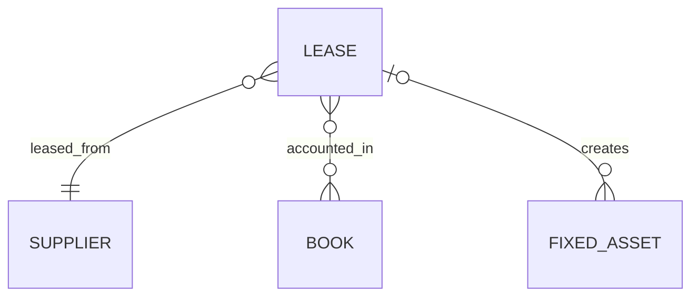
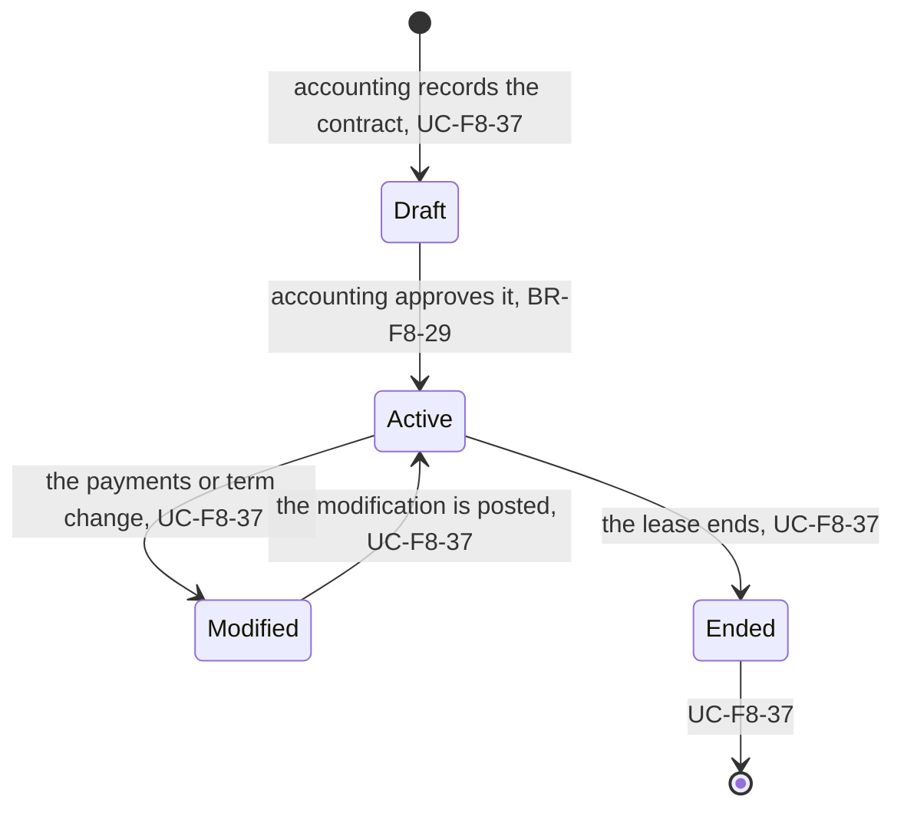

🏠 [Specs](../../../README.md) › 🧩 [Functional capabilities](../../README.md) › 📒 [F8 Accounting](../README.md) ›
🗃️ [Data](README.md) › 🗃️ E-F8-41 Lease

# 🗃️ E-F8-41 Lease

**Status:** ✅ specified

## Purpose

A lease of premises, a vehicle or equipment, with its payments and the way each book accounts for it
([D527](../../../06-decisions/f08-accounting/d527-benchmark-gaps-f08-accounting.md)).

## Fields

| Name | Type | Required | Validation | Default | Example | Personal data | Custom fields |
|---|---|---|---|---|---|---|---|
| name | text | yes | unique per company | - | Office Lyon 2026-2031 | no | no |
| lessor | supplier (E-F7-01) | yes | an active supplier | - | SCI Rhone | no | no |
| leased asset | text | yes | - | - | Office, 180 square metres | no | no |
| start date, term | date and months | yes | term of 1 or more months | - | 2026-12-01, 60 | no | no |
| payments | list of date and amount | yes | covers the term | computed | 60 x 2,400 EUR | no | no |
| indexation | none, yearly or by index | no | one of the three | none | yearly | no | no |
| options | renewal, purchase or termination | no | - | none | none | no | no |
| discount rate | percent | no | 0 or more, required for an IFRS book | - | 3.5 | no | no |
| deposit | amount with currency | no | 0 or more | 0 | 4,800 EUR | no | no |
| state | Draft, Active, Modified, Ended | yes | the lifecycle below | Draft | Active | no | no |
| owner | user | yes | a user of the company | the creator | Claire P. | yes | no |

## Relations

- [E-F7-01 Supplier record](../../f07-purchasing-and-stock/data/e-f07-01-supplier-record.md)
- [E-F8-13 Book](e-f08-13-book.md)
- [E-F8-07 Fixed asset](e-f08-07-fixed-asset.md)

## Lifecycle

## Indexes and search

By name, lessor, state, start date and end date.

## Retention

Kept 10 years after it ends with its entries
([CR-FR-002](../../../10-country-packs/france/accounting/cr-fr-002-accounting-records-kept-ten-years.md)).

## Audit

Every change of terms and every entry per book, with who, when and the standard applied.

## Import and export

Import leases from a CSV; export the schedule and the maturity table as a CSV or a PDF.

## Used by

- [UC-F8-37](../use-cases/12-audit-leases-and-special-books/uc-f08-37-account-for-leases.md)

## Open questions

None.

---

⬅️ [E-F8-40 Audit request](e-f08-40-audit-request.md) · ⬆️ [Up](README.md) ·
➡️ [E-F8-42 Peppol participant](e-f08-42-peppol-participant.md)
