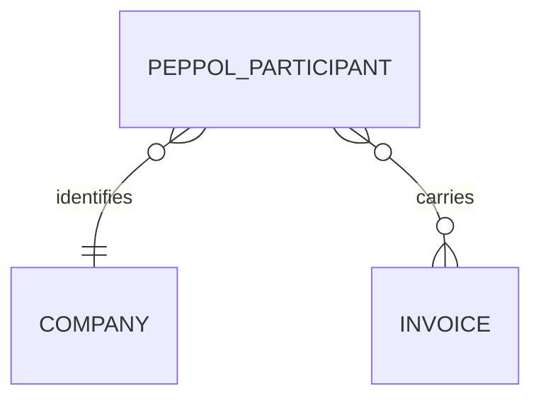
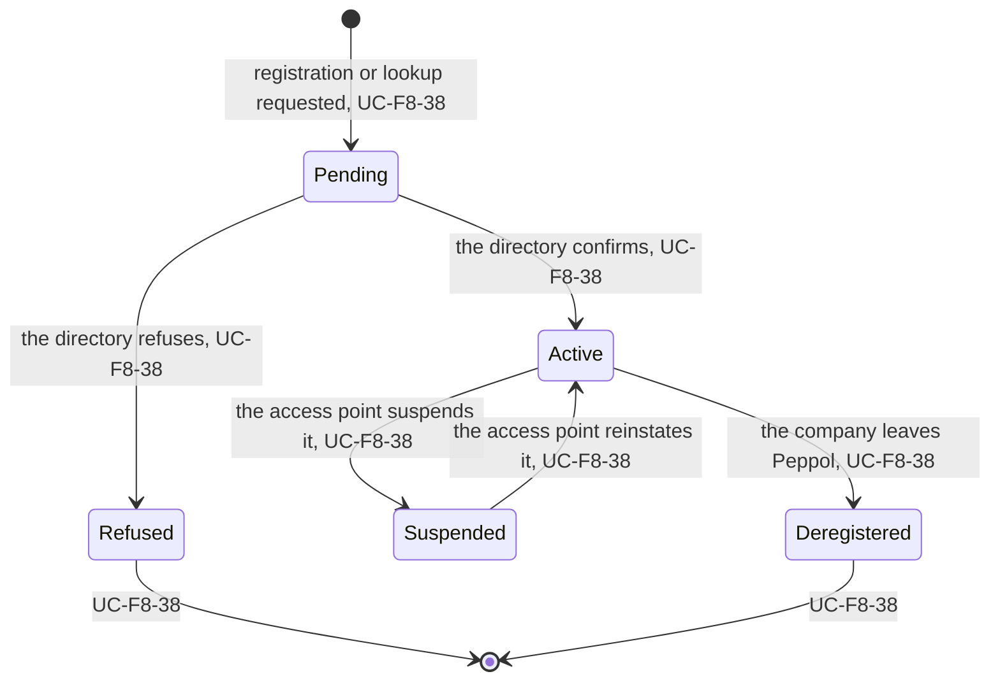

🏠 [Specs](../../../README.md) › 🧩 [Functional capabilities](../../README.md) › 📒 [F8 Accounting](../README.md) ›
🗃️ [Data](README.md) › 🗃️ E-F8-42 Peppol participant

# 🗃️ E-F8-42 Peppol participant

**Status:** ✅ specified

## Purpose

The company's own registration on Peppol and the directory entries of its counterparties
([D527](../../../06-decisions/f08-accounting/d527-benchmark-gaps-f08-accounting.md)).

## Fields

| Name | Type | Required | Validation | Default | Example | Personal data | Custom fields |
|---|---|---|---|---|---|---|---|
| company | company (E-F6-01 or own) | yes | the company or a counterparty | - | Atelier Verdier | no | no |
| scheme and identifier | text | yes | valid for the Peppol scheme | - | 0225:552081317 | no | no |
| access point | text | yes | a connected access point | - | Hub partner | no | no |
| capabilities | list | yes | invoice, credit note | invoice, credit note | invoice, credit note | no | no |
| country | country code | yes | ISO 3166 | - | FR | no | no |
| directory checked on | date | no | not in the future | - | 2026-11-14 | no | no |
| own registration | yes or no | yes | - | no | yes | no | no |
| state | Pending, Active, Refused, Suspended, Deregistered | yes | the lifecycle below | Pending | Active | no | no |
| owner | user | yes | a user of the company | the creator | Claire P. | yes | no |

## Relations

- [E-F6-01 Customer record](../../f06-customers-and-sales/data/e-f06-01-customer-record.md)
- [E-F6-05 Invoice](../../f06-customers-and-sales/data/e-f06-05-invoice.md)
- [E-F7-05 Supplier invoice](../../f07-purchasing-and-stock/data/e-f07-05-supplier-invoice.md)

## Lifecycle

## Indexes and search

By company, identifier, country, state and date of the last check.

## Retention

The company's own record is kept while it is registered and 10 years after; a counterparty's is refreshed
every 90 days and dropped after 2 years of no use.

## Audit

Every registration, lookup, state change and deregistration, with who or what, when and the directory answer.

## Import and export

No import. Export the exchanges as a CSV.

## Used by

- [UC-F8-38](../use-cases/12-audit-leases-and-special-books/uc-f08-38-send-and-receive-invoices-through-peppol.md)

## Open questions

None.

---

⬅️ [E-F8-41 Lease](e-f08-41-lease.md) · ⬆️ [Up](README.md) · ➡️ [E-F8-43 Trip](e-f08-43-trip.md)
